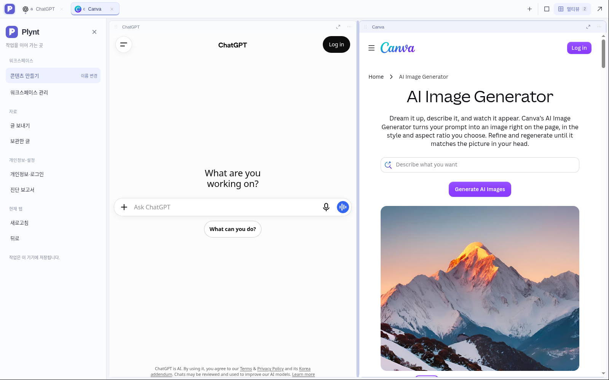
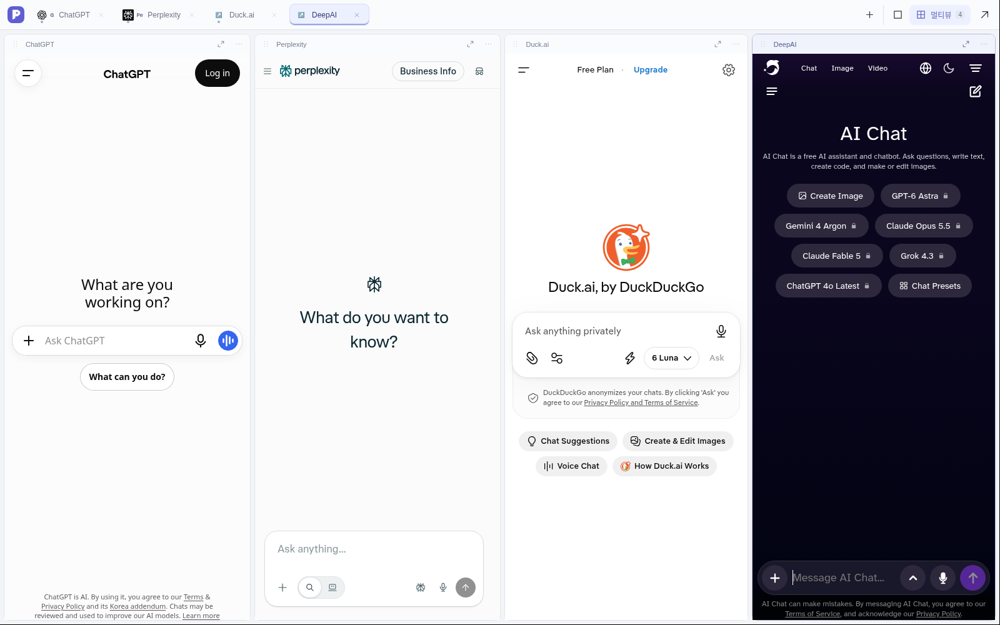

# Plynt · 플린트

[한국어](#plynt--플린트) · [English](#english)

**Plynt는 여러 AI의 작업 화면과 다시 쓸 글을 한곳에 모아, 다음 작업을 이어 가도록 돕는 앱입니다.**

ChatGPT의 채팅·프로젝트·Codex 작업을 오가고, 가사나 프롬프트를 Suno·Canva에 옮기다 보면 화면 전환과 복사·붙여넣기를 반복하게 됩니다. Plynt는 **작업을 다시 찾는 시간과 서비스 사이에서 글을 옮기는 수고를 줄이기 위해** 만들었습니다. 각 서비스의 원본 웹사이트를 탭으로 열고, 작업 구성을 저장하며, 사용자가 고른 글을 다른 탭의 입력칸에 넣습니다.

Windows·macOS·Linux용 데스크톱 프리뷰와 Android 호환성 시험 앱을 제공합니다. 다른 회사의 설치된 앱을 내부에서 실행하는 가상화 도구는 아닙니다. 일반 브라우저보다 얼마나 편리한지, 실제 AI 서비스의 로그인 후 입력이 호환되는지는 추가 사용 시험이 필요합니다.

[설치 파일 · preview.6](https://github.com/leemh-dev/plynt/releases/tag/v0.1.0-preview.6) · [변경·검증 기록](docs/preview.6-validation.md) · [빌드 상태](https://github.com/leemh-dev/plynt/actions/workflows/build.yml) · [오류 제보](https://github.com/leemh-dev/plynt/issues)

프로젝트와 저장소 이름은 **Plynt**입니다. 기존 설치의 작업과 로그인 상태를 유지하도록 데이터 경로와 앱 식별자는 유지합니다. [이름 변경 기록](docs/plynt-rename.md)

[소개 페이지](https://leemh-dev.github.io/plynt/) · [페이지 소스](site/) · [작업 계획·진행 상태](docs/modification-plan.md) · [소개 페이지·스토어 배포 검토](docs/landing-and-store-review.md)

## 실제 앱 화면

Linux용 Plynt에서 실제 서비스의 공개 웹 화면을 열어 촬영했습니다. 로그인된 개인 계정이나 대화는 사용하지 않았습니다.



ChatGPT 채팅 입력 화면과 Canva의 공개 AI Image Generator 입력 화면입니다. Canva의 로그인 후 디자인 편집 화면은 아닙니다.

<details>
<summary>ChatGPT · Perplexity · Duck.ai · DeepAI를 좌우 4열로 보기</summary>



4개 서비스의 입력 화면이 로그인 없이 표시되는 것을 확인했습니다. 이 사진도 Linux 앱에서 촬영했으며 Android 태블릿 사진이 아닙니다.

</details>

이번 촬영은 화면 열기·입력칸 표시 확인까지 진행했습니다. 답변·이미지 생성이나 로그인 후 글 전달 성공을 입증하는 사진은 아닙니다. [촬영 환경·확인 범위](docs/public-service-screenshots.md)

## 무엇을 할 수 있나요?

- **작업 화면 모으기:** 같은 서비스도 여러 탭으로 열고 별칭을 붙입니다. 최대 30개 탭, 데스크톱·Android 태블릿에서는 최대 4개 패널을 2×2 또는 좌우 4열로 배치합니다. 멀티뷰 밖의 탭은 한 화면으로 열립니다.
- **글 옮기기:** 블록 선택 후 우클릭 또는 길게 누르기로 대상 탭을 고릅니다. 답변의 복사 버튼을 쓴 뒤 상단 `↗`에서 **복사한 글 보내기**도 가능합니다. 대상 탭이 활성화되며, 빈 입력칸을 터치한 뒤 **여기에 넣기**로 입력합니다. 입력칸을 미리 등록할 필요 없이 대상을 먼저 고를 수 있습니다.
- **계속 작업하기:** 워크스페이스에 이름을 붙여 저장·다른 이름으로 저장·전환합니다. 탭의 URL·별칭·순서·활성 탭, 보관 글과 최근 전달 대상을 로컬에 저장합니다. 데스크톱과 Android 태블릿은 패널 배치도 저장합니다. 목록의 **이름 변경**으로 다른 워크스페이스의 이름도 전환 없이 바꿉니다.
- **빠르게 서비스 찾기:** 8개 분류의 47개 서비스 바로가기, 검색, 아이콘과 약자를 제공합니다. 검색창 아래 분류를 좌우로 밀어 여러 개 선택할 수 있습니다. `All`이 기본이며 맨 위 Google 바로가기는 일반 브라우저 탭을 엽니다.
- **글 재사용:** 선택한 글을 명시적으로 보관하고 나중에 다시 보냅니다. 최대 50개, 항목당 5만 자입니다. 최근 목적지에도 다시 보낼 수 있습니다.

ChatGPT 탭에는 **답변 가져오기 · 시험** 기능도 있습니다. 화면에 로드된 답변을 후보로 보여 드리고, 사용자가 선택한 답변을 미리 본 뒤 전달합니다. 현재 합성 화면에서만 확인한 실험 기능이며, 실제 ChatGPT 화면 구조가 바뀌면 동작하지 않을 수 있습니다. 답변의 복사 버튼을 이용하는 방법도 제공합니다.

**전송·생성·게시 버튼은 자동으로 누르지 않습니다.** 기존 입력이 있는 칸에는 덮어쓰지 않으며, 실패한 글은 전달 대기 상태로 남깁니다. 이미지·음악·파일 전달은 지원하지 않습니다.

## 설치

Releases의 **Assets**에서 운영체제에 맞는 파일을 받으세요. `Source code.zip`은 설치 파일이 아닙니다. 실제 첨부된 파일만 배포된 파일이며, `SHA256SUMS.txt`로 무결성을 확인할 수 있습니다.

| 환경 | 파일 |
|---|---|
| Windows x64 | `plynt-…-win-x64.exe` 또는 압축 해제 후 실행하는 `.zip` |
| Mac Apple Silicon | `plynt-…-mac-arm64.dmg` 또는 `.zip` |
| Mac Intel | `plynt-…-mac-x64.dmg` 또는 `.zip` |
| Linux x64 | `plynt-…-linux-x86_64.AppImage` |
| Debian / Ubuntu x64 | `plynt-…-linux-amd64.deb` |
| Android 시험 앱 | `plynt-…-android-test.apk` |

Android는 별도 네이티브 WebView 시험 앱입니다. 최소 화면 폭 600dp 이상인 태블릿에서는 최대 4개 패널을 지원하며, 휴대폰은 단일 화면입니다. iOS 버전은 없습니다. **preview.5에서 preview.6으로는 같은 앱 ID·서명 키를 유지해 업데이트합니다.** **기존 공개 preview.4 APK와 preview.5 APK는 서명이 달라 덮어 설치할 수 없습니다.** 삭제하면 로컬 탭·보관 글·로그인이 지워지므로, 필요한 URL과 자료를 먼저 별도로 보관하세요. preview.5부터 배포 APK는 보관된 동일 키로 서명하도록 분리했습니다. CI 임시 키 APK는 업데이트용으로 배포하지 않습니다. [Android 설치·서명 안내](mobile/android/README.md)

데스크톱 설치 파일은 공인 코드 서명과 Apple 공증을 하지 않은 프리뷰입니다. OS 정책에 따라 실행이 제한될 수 있습니다. 설치 파일 생성, 앱 실행, 설치 관리자의 전체 동작은 서로 다른 검사입니다.

AppImage에서 FUSE가 없다는 오류가 나면 다음 런타임 옵션을 사용할 수 있습니다.

```sh
chmod +x plynt-0.1.0-preview.6-linux-x86_64.AppImage
./plynt-0.1.0-preview.6-linux-x86_64.AppImage --appimage-extract-and-run
```

## 처음 사용하는 순서

1. `+`에서 서비스나 웹 주소를 엽니다. 기존 비공개 대화 URL도 사용할 수 있습니다.
2. 각 서비스의 정상 로그인 화면에서 직접 로그인합니다. 같은 서비스의 탭은 해당 기기의 세션을 공유합니다.
3. 탭 별칭은 데스크톱에서 더블클릭, Android에서 길게 눌러 변경합니다.
4. 글을 선택해 **다른 탭에 넣기**를 누르거나, 서비스의 복사 버튼을 누른 뒤 상단 `↗`의 복사한 글 보내기를 엽니다.
5. 내용을 확인하고 대상 탭을 고릅니다. 입력칸이 등록되지 않았다면 목적지의 **빈 칸을 터치 → 여기에 넣기**로 진행합니다. 등록한 칸은 다시 사용할 수 있습니다.
6. 입력 결과와 줄바꿈을 확인합니다. Suno의 가사·스타일처럼 여러 입력칸이 있으면 각각 등록하세요. Canva 검색칸에 글을 넣은 것은 디자인 편집 완료와 다릅니다.
7. `맨 앞 플린트 아이콘 → 워크스페이스 관리`에서 이름을 붙이고 저장합니다. 목록의 `이름 변경`으로 현재 열지 않은 작업도 바로 수정합니다. 탭 구성은 변경할 때 자동 저장하며, 저장 상태도 표시합니다.

탭 URL과 배치는 복원하지만 웹사이트 내부의 작성 중인 초안·스크롤·편집 상태까지 복원하지는 않습니다. 웹페이지가 입력칸을 교체하거나 이동하면 다시 지정해야 합니다. iframe 안의 입력칸 등 일부 편집기는 지원하지 않습니다.

## 로그인·저장·진단

정상 로그인으로 웹 엔진에 저장된 쿠키와 웹 저장소는 다음 실행에서도 재사용합니다. 이는 **세션 저장 기능**이며 비밀번호 저장·다른 브라우저 쿠키 가져오기·로그인 우회가 아닙니다. 서비스가 세션을 만료시키거나 내장 브라우저 로그인을 제한하면 다시 로그인해야 합니다. `플린트 아이콘 → 개인정보·로그인` 메뉴에서 확인 후 로그인 데이터를 지울 수 있습니다. 워크스페이스를 전환해도 같은 기기의 서비스 세션을 공유합니다.

워크스페이스와 보관 글은 기기 내에 저장합니다. 자체 계정·클라우드 동기화·기기간 공유는 없습니다. 사생활 보호가 필요한 URL과 글이 포함될 수 있으므로 작업 저장 파일이나 앱 프로필을 공개하지 마세요. 이전 단일 작업 저장본은 새 워크스페이스 저장소로 읽어 들이며, 손상된 저장본은 백업 복원 또는 쓰기 중단으로 보호합니다.

`플린트 아이콘 → 진단 보고서`에서 미리 보고 JSON으로 내보낼 수 있습니다. 자동 업로드하지 않습니다.

- 포함: 앱·OS·웹 엔진 버전, 허용된 동작·결과·오류 코드, 글자 수 등.
- 제외: 대화·프롬프트 원문, URL, 별칭, 비밀번호, 쿠키·토큰, 페이지 콘솔, 원본 오류 스택, 화면 캡처.
- 수집 중지와 기록 삭제가 가능합니다. 앱의 진단 기능은 화면을 캡처하지 않습니다.

## 확인된 범위

Windows·macOS·Linux의 실제 Electron 실행에서 새 전달 흐름·분류·워크스페이스·합성 쿠키 재시작 검사를 실행했습니다. Android는 실제 에뮬레이터의 네이티브 메뉴와 WebView로 별도 검사합니다. **합성 쿠키 복원 성공이 실제 ChatGPT·Suno·Canva 로그인 성공을 의미하지는 않습니다.** 정확한 항목별 결과와 화면은 [preview.6 검증 기록](docs/preview.6-validation.md)에 있습니다.

별도로 Linux 앱의 새 프로필에서 ChatGPT·Canva·Perplexity·Duck.ai·DeepAI의 공개 페이지와 활성화된 입력칸 표시를 확인하고 소개 사진을 촬영했습니다. 메시지 전송·생성은 수행하지 않았으며, [실제 서비스 화면 확인 기록](docs/public-service-screenshots.md)을 합성 회귀 검사와 구분합니다.

실제 서비스 로그인 후 입력, 파일 전달, 일반 브라우저 대비 조작·시간 절감, 시장 수요는 검증되지 않았습니다. Codex 바로가기는 Codex Cloud 웹 화면이며 데스크톱 원격 Codex의 모든 기능을 지원한다는 뜻이 아닙니다.

[이전 preview.4 검증](docs/preview.4-validation.md) · [초기 Android 제한 기록](docs/preview.2-validation.md) · [서비스 목록과 출처](docs/ai-shortcuts.md) · [번들 아이콘 출처](src/assets/services/sources.json)

## 소개 페이지

소개 페이지는 **[https://leemh-dev.github.io/plynt/](https://leemh-dev.github.io/plynt/)** 에 공개돼 있습니다. 개인정보 안내·스타일·파비콘과 새 실제 서비스 사진 2장의 HTTP 200 응답 및 저장소 원본 일치를 확인했습니다. `site/` 또는 [Pages 배포 워크플로](.github/workflows/pages.yml)를 변경해 `main`에 올리면 자동으로 다시 배포합니다.

## Google Play 배포 준비

**2026-11-19 확인 기준, Google Play에는 아직 등록하지 않았습니다.** 현재 무료 프리뷰는 GitHub Releases에서 APK를 직접 내려받아 설치하는 방식입니다.

- **빌드:** 현재 Android 앱은 API 35를 대상으로 하며 디버그 설정이 켜진 시험용 APK입니다. 신규 등록에는 API 36 이상 대응·실제 동작 확인, 정식 배포 설정과 서명한 AAB, Play App Signing 준비가 필요합니다. [API 기준](https://support.google.com/googleplay/android-developer/answer/11926878?hl=en) · [AAB·서명 안내](https://support.google.com/googleplay/android-developer/answer/9844279?hl=en)
- **개발자 계정:** 등록비는 개발자 계정당 최초 1회 **미화 25달러**입니다. 무료 앱을 올릴 때도 필요하며 앱별 요금이나 월정액은 아닙니다. 본인·기기 확인 등 계정별 절차도 필요합니다. [공식 등록 안내](https://support.google.com/googleplay/android-developer/answer/6112435?hl=en)
- **출시 전 테스트:** 2023-11-13 이후 개설한 개인 계정은 **최소 12명이 연속 14일 참여한 비공개 테스트** 후 프로덕션 접근을 신청해야 합니다. 기간 충족만으로 출시가 자동 승인되지는 않습니다. [공식 테스트 요건](https://support.google.com/googleplay/android-developer/answer/14151465?hl=en)
- **심사 자료:** 앱 설명·Android 화면 사진·지원 연락처·개인정보처리방침·Data safety 신고를 준비하고 실제 데이터 처리와 일치하는지 확인해야 합니다. 소개 페이지의 Linux 사진은 Android 실행 증거로 쓰지 않습니다.

Google은 사이트 소유자 허락 없이 해당 웹사이트의 웹뷰 제공을 주목적으로 하는 앱을 제한합니다. Plynt의 탭·워크스페이스·글 전달 기능은 자체 기능이지만 심사 승인을 보장하지 않습니다. 연결 서비스의 이용 조건·브랜드 표시·로그인 호환성을 별도로 검토해야 합니다. [Google WebView 정책](https://support.google.com/googleplay/android-developer/answer/9899034?hl=en) · [사용자 데이터 정책](https://support.google.com/googleplay/android-developer/answer/10144311?hl=en) · [초기 플랫폼별 배포 검토](docs/landing-and-store-review.md)

스토어용 빌드 제작·개발자 계정 등록·결제·심사 제출은 아직 진행하지 않았습니다.

## 개발과 배포

Node.js 22.12 이상이 필요합니다.

```sh
git clone https://github.com/leemh-dev/plynt.git plynt
cd plynt
npm ci
npm run setup
npm start
npm test
npm run fixtures
```

자동 회귀 검사는 로그인된 사용자 프로필을 사용하지 않고 임시 프로필과 합성 페이지로 실행합니다. 공개 서비스 화면 촬영은 별도 새 프로필에서 수행하며 위 촬영 기록에 범위를 남깁니다.

```sh
node tests/run-cross-platform.cjs       # Windows / macOS
xvfb-run -a node tests/run-cross-platform.cjs  # Linux
python tests/run-desktop-linux.py      # 추가 배치·메뉴 검사; Xvfb/Pillow/X11 필요
npm run dist -- --win --x64
npm run dist -- --mac --x64 --arm64
npm run dist -- --linux --x64
```

[GitHub Actions](.github/workflows/build.yml)는 각 데스크톱 OS에서 앱 실행 검사 후 설치 파일을 만들고, 별도로 Android 15 에뮬레이터 검사를 실행합니다. `v*` 태그의 검사가 모두 통과하면 데스크톱 파일을 사전 릴리스에 올립니다. Android APK는 보관 키로 별도 빌드하고 `scripts/publish-android-preview.py`로 서명을 확인한 뒤 첨부하며, 9개 설치 파일의 체크섬을 갱신합니다. 자동 업데이트는 없습니다.

릴리스 태그는 `package.json` 버전과 일치해야 하며 `docs/releases/<태그>.md`가 필요합니다. Android 빌드는 [별도 안내](mobile/android/README.md)를 따릅니다. 서명 키·작업 파일·브라우저 프로필·로그를 커밋하지 마세요.

```text
src/              데스크톱, 공통 입력 코드·서비스 목록·아이콘
mobile/android/   Android Java 앱과 SDK 빌드
build/            데스크톱 패키징 아이콘
scripts/          아이콘 출처 수집과 Android 배포 보조
tests/            저장·진단·합성 UI 검사
docs/             검증 기록·합성 시험·공개 서비스 화면 증거
```

프로젝트 코드에는 별도의 오픈소스 라이선스를 지정하지 않았습니다. 서비스 로고는 각 권리자의 식별 표지이며 제휴를 의미하지 않습니다. 번들 아이콘의 출처·라이선스는 별도 기록합니다.

---

## English

**Plynt brings AI task screens and reusable text together so you can continue working across services.**

Switching between ChatGPT chats, projects, Codex tasks, Suno and Canva often means repeatedly finding the right screen, copying text and finding its destination. Plynt opens original websites in tabs, saves named workspaces and inserts user-chosen text into a receiving field. It is a desktop preview for Windows, macOS and Linux, with a separate Android compatibility app. It does not embed other companies’ installed native apps.

[Website](https://leemh-dev.github.io/plynt/) · [Installers · preview.6](https://github.com/leemh-dev/plynt/releases/tag/v0.1.0-preview.6) · [Validation record, Korean](docs/preview.6-validation.md) · [Build status](https://github.com/leemh-dev/plynt/actions/workflows/build.yml)

The project and repository are named **Plynt**. App identifiers and profile paths are retained for existing installations.

[Planned changes, Korean](docs/modification-plan.md) · [Landing page and store review, Korean](docs/landing-and-store-review.md)

### Actual app screens

[ChatGPT + Canva](site/assets/desktop-chatgpt-canva.png) · [Four AI panels](site/assets/desktop-four-ai.png)

Both screenshots show the real Linux app with a fresh, signed-out profile. The two-panel image shows ChatGPT and Canva's public AI Image Generator input page, not Canva's authenticated design editor. The four columns show ChatGPT, Perplexity, Duck.ai and DeepAI. These are desktop captures, not Android tablet screenshots.

We verified that public pages and enabled input controls were visible. No messages were submitted and no images were generated; authenticated workflows remain unverified. See the [capture and deployment record, Korean](docs/public-service-screenshots.md).

### Features

- A leading Plynt icon opens the sidebar for workspaces, saved text, privacy and diagnostics. Rename any saved workspace without switching or reloading the current work.
- Up to 30 tabs, editable aliases and an active-tab highlight. Desktop and Android tablet multiview support up to four panels in a 2×2 grid or four columns from left to right. Other tabs open in a single view.
- Select text and use the context menu, or copy a whole response with the service’s copy button and use the top `↗` menu. Preview the text, choose a tab, touch its empty field and press **여기에 넣기** (insert here). Unregistered tabs are included. Registered fields and recent destinations can be reused.
- Named local workspaces: save, save as, new empty workspace, switch and restore. URLs, aliases, tab order, active tab, saved text and recent targets persist; desktop and Android tablets also save layouts.
- 47 service shortcuts across eight categories, bundled icons and monograms. Drag the horizontal category row, select several categories, or reset with `All`. Google is pinned above the results to open an ordinary browsing tab.
- Explicitly save up to 50 text items, each up to 50,000 characters. The clipboard is read only when requested, not continuously monitored.

The experimental ChatGPT answer importer offers loaded assistant responses for selection and preview. It is tested on synthetic pages only and may break when the actual service changes. Using the service’s copy button is also supported.

Plynt does not automatically send, generate or publish. Existing destination text is protected. Failed transfers remain pending. Image, audio and file transfer are not implemented.

### Installation

Choose the matching file under **Assets** in the release, not `Source code.zip`.

| Platform | File |
|---|---|
| Windows x64 | `*-win-x64.exe` or portable `.zip` |
| Mac Apple Silicon / Intel | `*-mac-arm64.dmg` / `*-mac-x64.dmg`, or `.zip` |
| Linux x64 | `*-linux-x86_64.AppImage` or `*-linux-amd64.deb` |
| Android compatibility preview | `*-android-test.apk` |

Only attached assets are published downloads. Check `SHA256SUMS.txt`. Desktop installers are not publicly code-signed or Apple-notarized, so OS policies may restrict execution. Successful app execution is separate from testing every installer flow.

**The public preview.4 Android APK and preview.5 APK have different signing certificates and cannot update in place.** Uninstalling deletes local workspaces, text and sessions; separately preserve needed URLs and material before considering removal. From preview.5 onward, release APKs use a retained key; ephemeral CI APKs are excluded from release publication. See the [Android guide](mobile/android/README.md). Android tablets with smallest screen width ≥600dp support up to four panels in a 2×2 grid or side-by-side columns, with drag-to-swap headers. Phones use one panel. There is no iOS app. Preview.6 retains the preview.5 application ID and signing key.

### Use and privacy

Open a service with `+`, sign in through its normal login flow, then choose text to transfer. Desktop tabs can be renamed by double-clicking; Android tabs by long press. Use `맨 앞 플린트 아이콘 → 워크스페이스 관리` to save or switch named workspaces. Receiving fields may need registration again after navigation. Suno lyrics and style fields should be registered separately. Inserting a Canva search prompt does not prove that a design has been edited.

Normal engine-managed cookies and web storage persist across launches. This is session persistence, not password storage, cookie import or an authentication bypass. Services can expire sessions or reject embedded browsers. A confirmation-gated menu clears login data. Workspaces on the same device share service sessions.

Workspace storage is local; there is no Plynt account or cloud synchronization. Site drafts, scroll position and editor state are not guaranteed to restore. Workspaces and saved text can contain private material and must not be shared as diagnostic files.

`플린트 아이콘 → 진단 보고서` previews and exports local diagnostics. Reports contain permitted events, outcomes, versions, error codes and counts, but exclude text, URLs, aliases, credentials, cookies, tokens, screenshots and page console output. There is no automatic upload; collection can be disabled and records deleted.

Native Electron checks run on Windows, macOS and Linux. Android uses a real Android 15 emulator and synthetic WebViews. **A synthetic persistent-cookie check is not proof of real-service sign-in compatibility.** Authenticated ChatGPT → Suno/Canva insertion, file transfer, comparative efficiency and demand remain unverified. Codex shortcuts open Codex Cloud, not every remote desktop Codex feature.

### Google Play readiness

As checked on **2026-11-19**, Plynt is distributed as a free APK through GitHub Releases and is not listed on Google Play.

- The current Android preview targets API 35 and enables debugging. A Play release needs API 36+ compatibility validation, release configuration, a signed AAB and Play App Signing. See the [target API requirements](https://support.google.com/googleplay/android-developer/answer/11926878?hl=en) and [AAB requirements](https://support.google.com/googleplay/android-developer/answer/9844279?hl=en).
- The developer account has a **one-time US$25 registration fee**, including for free apps; it is not charged per app or monthly. Identity/device verification requirements also apply. [Registration guide](https://support.google.com/googleplay/android-developer/answer/6112435?hl=en)
- Personal accounts created after November 13, 2023 must complete a closed test with **at least 12 testers opted in continuously for 14 days** before applying for production access. Meeting the duration alone does not guarantee approval. [Testing requirements](https://support.google.com/googleplay/android-developer/answer/14151465?hl=en)
- Store descriptions, Android screenshots, support details, a privacy policy and accurate Data safety declarations still need preparation and review. The Linux screenshots above are not Android execution evidence.

Plynt's own tab, workspace and text-handoff features do not guarantee approval under Google's [WebView policy](https://support.google.com/googleplay/android-developer/answer/9899034?hl=en). Service terms, branding, authentication compatibility and [data practices](https://support.google.com/googleplay/android-developer/answer/10144311?hl=en) also need review. No store build, account registration, payment or review submission has been performed.

### Development and release

Use Node.js 22.12+, `npm ci`, `npm run setup`, then `npm start`. `npm test` checks storage and diagnostics; `npm run fixtures` opens synthetic pages. `node tests/run-cross-platform.cjs` runs isolated native UI checks (use `xvfb-run -a` on Linux). See the Korean section for build commands and directory layout.

Actions builds desktop installers after native checks and runs separate Android emulator checks. Tagged releases publish desktop assets after all checks pass. The Android publisher verifies the retained certificate, attaches the separately signed APK and refreshes checksums for all nine installer assets. Automatic updates are not implemented. Keys, browser profiles, workspace files and runtime logs must stay outside Git.

The project has no separate open-source code license. Service icons identify their respective owners and do not imply affiliation; [icon provenance](src/assets/services/sources.json) is recorded separately.
