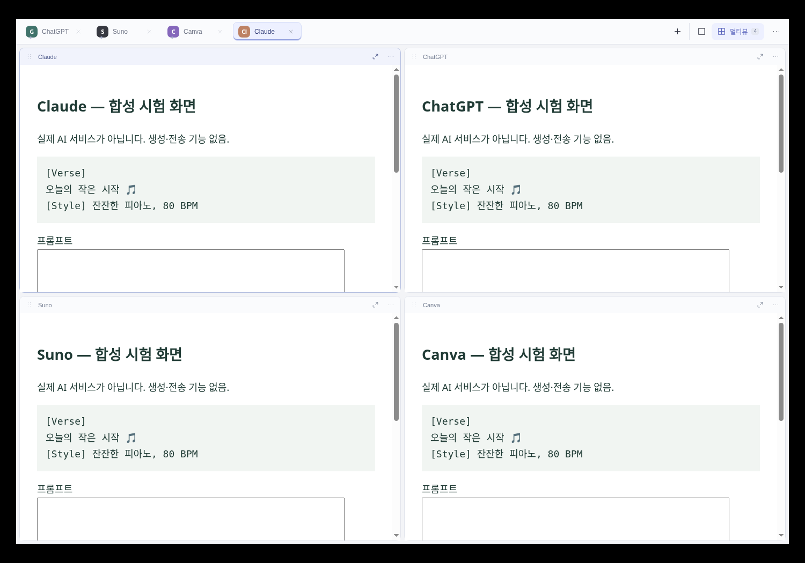
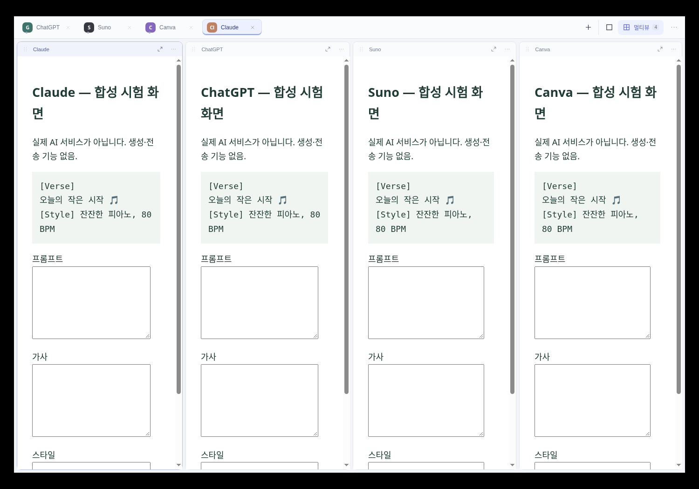

# Plynt · 플린트

[한국어](#plynt--플린트) · [English](#english)

**Plynt는 여러 AI의 대화·작업 화면과 다시 쓸 글을 한곳에 모아, 다음 작업을 이어 가도록 돕는 데스크톱 앱입니다.**

프로젝트 이름을 **Naru(나루)에서 Plynt(플린트)**로 변경했습니다. GitHub 저장소 주소는 현재 `leemh-dev/naru`입니다. 기존 설치의 작업·로그인 데이터 경로와 앱 식별자는 유지하며, 과거 검증 기록과 캡처에는 시험 당시 이름이 남아 있습니다.

[이름 변경과 검증 기록](docs/plynt-rename.md)

## 왜 만들었나요?

여러 AI를 함께 쓰다 보면 하나의 작업도 여러 화면에 흩어집니다. ChatGPT의 일반 대화와 프로젝트 대화, Codex 작업을 오가고, 필요한 모델이 있으면 다른 서비스를 엽니다. 작성한 가사나 프롬프트를 Suno·Canva에서 쓰려면 원문을 다시 찾고, 복사하고, 목적지의 입력칸으로 이동해야 합니다.

Plynt는 **진행 중인 작업을 찾느라 화면을 반복해서 넘기는 불편과, 서비스 사이에서 같은 글을 다시 찾아 옮기는 불편**을 줄이기 위해 만들었습니다. 휴대폰에서 여러 AI를 오가며 느낀 불편에서 출발했으며, 현재는 Windows·macOS·Linux용 데스크톱 프리뷰부터 구현하고 있습니다.

목표는 작업 화면과 필요한 글을 한곳에 두고 이어서 사용하는 것입니다. 실제로 일반 브라우저나 개별 앱보다 얼마나 편리한지는 비교 사용 시험이 필요합니다.

## Plynt로 무엇을 할 수 있나요?

- **진행 중인 작업을 나란히 볼 수 있습니다.** ChatGPT·Codex Cloud·Claude·Suno·Midjourney·Canva의 원본 웹 화면을 탭으로 열고, 작업별 별칭을 붙이며, 최대 4개 화면을 나란히 배치합니다. 같은 서비스를 여러 탭으로 열 수도 있습니다.
- **선택한 글을 다음 작업의 입력칸에 넣을 수 있습니다.** 받을 칸을 먼저 지정한 뒤, 원문을 선택하고 우클릭 메뉴에서 대상 탭을 고릅니다. 입력 결과가 원문과 같은지 확인하며, 기존 내용이 있는 칸에는 덮어쓰지 않습니다.
- **자주 쓰는 글과 작업 구성을 다시 사용할 수 있습니다.** 선택한 글을 보관해 다른 작업에서 꺼내 쓰고, 앱을 다시 열면 저장된 탭 주소·별칭·화면 배치를 복원합니다.

예를 들어 글을 다듬는 화면과 다음 작업의 입력 화면을 함께 띄워 놓고, 필요한 문구만 골라 전달할 수 있습니다. 반복해서 쓰는 스타일 지시나 작성 규칙은 보관함에 넣어 두었다가 다시 사용할 수 있습니다.

현재는 **사용자 설치 시험을 위한 프리뷰**입니다. 실제 서비스의 로그인 허용 여부와 로그인 후 입력 호환성은 아직 확인이 필요합니다. 다른 회사의 네이티브 앱을 안에 실행하는 가상화 도구는 아닙니다.

초기 프리뷰에서 한 줄 시험 글을 ChatGPT 입력칸에서 Canva의 공개 입력칸으로 옮기는 것은 확인했습니다. **Suno·Canva의 로그인 후 실제 작업 화면에서의 전달, 이미지·음악·파일 전달, 기기 간 동기화까지 지원한다는 의미는 아닙니다.** 자세한 범위는 아래 기능과 검증 기록을 참고하세요.

[다운로드 · Plynt 0.1.0-preview.3](https://github.com/leemh-dev/naru/releases/tag/v0.1.0-preview.3) · [빌드 상태](https://github.com/leemh-dev/naru/actions/workflows/build.yml) · [오류 제보](https://github.com/leemh-dev/naru/issues)

## 다운로드와 실행

Releases에서 **Assets**를 펼쳐 운영체제와 CPU에 맞는 파일을 받으세요. `Source code.zip`은 설치 파일이 아닌 개발 소스입니다.

**Plynt 설치 파일은 `v0.1.0-preview.3` 릴리스에서 확인합니다.** 기존 `v0.1.0-preview.1`·`preview.2`의 Naru 설치 파일은 과거 버전으로 보존합니다. Releases에 실제로 첨부된 파일만 배포 완료된 파일입니다.

| 환경 | 배포 파일 | 실행 방법 |
|---|---|---|
| Windows x64 | `plynt-…-win-x64.exe` | 설치 마법사로 설치합니다. |
| Windows x64, 무설치 | `plynt-…-win-x64.zip` | 폴더 전체를 풀고 `Plynt.exe`를 실행합니다. |
| Mac Apple Silicon | `plynt-…-mac-arm64.dmg` 또는 `.zip` | DMG에서 앱을 Applications로 옮기거나 ZIP의 `Plynt.app`을 옮깁니다. |
| Mac Intel | `plynt-…-mac-x64.dmg` 또는 `.zip` | Intel용 앱을 위와 같은 방식으로 사용합니다. |
| Linux x64 | `plynt-…-linux-x86_64.AppImage` | 파일에 실행 권한을 부여한 뒤 실행합니다. |
| Debian·Ubuntu x64 | `plynt-…-linux-amd64.deb` | 배포판 패키지 설치기로 설치합니다. |
| Android 호환성 시험용 | `plynt-…-android-test.apk` | 디버그 서명 시험 앱입니다. 아래 검증 한계를 확인하세요. |

Android APK는 데스크톱과 기능이 같지 않은 별도 시험 앱입니다. 에뮬레이터에서 앱 시작과 진단 기록은 확인했지만 WebView 종료·네트워크 오류로 **길게 누르기 전달과 로그인 완료는 미검증**입니다. [Android 범위와 빌드](mobile/android/README.md) · [실제 시험 결과](docs/preview.2-validation.md)

릴리스에 실제로 첨부된 파일이 배포 완료된 파일입니다. 함께 제공하는 `SHA256SUMS.txt`로 다운로드 파일의 체크섬을 확인할 수 있습니다.

Linux에서 `libfuse.so.2`가 없다는 오류가 나오면 AppImage 런타임의 추출 실행 옵션을 사용할 수 있습니다.

```sh
chmod +x plynt-0.1.0-preview.3-linux-x86_64.AppImage
./plynt-0.1.0-preview.3-linux-x86_64.AppImage --appimage-extract-and-run
```

이 방법으로 Debian 13의 사용자 폴더에 둔 **0.1.0-preview.1 릴리스 AppImage**를 실행해 확인했습니다. 시스템 전체에 deb를 설치한 시험은 아닙니다. [Linux 실행 시험과 화면 증거](docs/linux-installed-test-2026-11-17.md)를 참고하세요.

프리뷰는 **코드 서명·Apple 공증을 하지 않았습니다.** 운영체제 보안 정책이 설치·실행을 제한할 수 있습니다. 이런 경우 경고와 발생 단계를 기록하고 시스템 보호 기능을 일괄 해제하지 마세요. 설치 파일 생성 성공과 해당 OS에서 앱이 정상 실행되는지는 별도의 검증 항목입니다.

## 구현된 기능

| 기능 | 현재 동작 |
|---|---|
| 작업 탭 | 동일 서비스를 여러 번 열기, 고정된 서비스 표시와 사용자 별칭, 좌우 스크롤·드래그 |
| 화면 배치 | 단일 화면, 가로 **2×2**, 세로 **좌우 1×4**; 1~3개 자동 배치 |
| 패널 이동 | 머리글 핸들로 위치 교환·가장자리 분할, 경계 드래그로 비율 조절 |
| 작업 복원 | URL·별칭·표시 패널·배치·보관한 글을 이 PC에 자동 저장 |
| 글 전달 | 받을 칸을 먼저 지정한 뒤 선택 글 우클릭 → 대상 탭·필드 선택 |
| 원문 보호 | 입력 결과를 원문과 비교하고, 기존 글이 있으면 덮어쓰지 않고 중단 |
| 글 보관 | 선택한 글을 명시적으로 복사·보관하고 다른 작업에서 재사용 |
| 진단 | 로컬 로그, 미리 보기, JSON 내보내기, 수집 중지·삭제 |

작업 탭은 최대 **30개**, 멀티뷰는 최대 **4개 패널**입니다. `멀티뷰`에서 함께 볼 탭을 직접 고릅니다. 구성에 없는 탭은 작업 영역 전체로 열리며, 구성원 탭을 다시 선택하면 저장된 멀티뷰와 조절한 너비로 돌아옵니다. 활성 탭은 은은하게 강조되며 글을 전달하면 대상 탭과 입력칸으로 이동합니다. 보관한 글은 최대 50개, 한 항목과 한 번의 전달은 최대 5만 자입니다.

아래는 **비민감 합성 화면으로 실제 앱을 실행한 증거**입니다. 실제 AI 서비스 로그인 후 동작을 보여 주는 화면은 아닙니다.

| 가로 2×2 | 세로 좌우 1×4 |
|---|---|
|  |  |

## 첫 사용과 입력 시험

1. 중앙 또는 상단의 `+`에서 서비스나 웹 주소를 추가합니다. 기존 비공개 대화 주소도 사용할 수 있습니다.
2. 각 서비스 화면에서 본인이 직접 정상 로그인합니다. 동일 서비스의 탭들은 로그인 세션을 공유합니다. 다른 브라우저에서 쿠키·비밀번호를 가져오지 않습니다.
3. 탭을 더블클릭해 별칭을 정합니다. 원본 대화 제목은 바꾸지 않습니다. 상단 `멀티뷰`에서 최대 4개 탭과 배치를 선택합니다. `한 화면으로 보기`로 잠시 확대해도 멀티뷰 구성은 유지됩니다.
4. 목적지의 **빈 텍스트 입력칸을 클릭한 다음 우클릭 → 받을 입력칸 지정 → 프롬프트·가사·스타일** 중 하나를 선택합니다.
5. 원문에서 필요한 부분을 선택하고 **우클릭 → 다른 작업에 넣기 → 대상 탭·입력칸**을 선택합니다.
6. 원문·줄바꿈 일치 여부와 실제 입력 결과를 확인합니다. **Plynt는 메시지 전송·음악 생성·외부 게시 버튼을 자동으로 누르지 않습니다.**
7. 반복해서 쓸 글은 **우클릭 → 복사하고 보관**을 선택합니다. `··· → 보관한 글`에서 복사하거나 지정한 칸에 다시 넣습니다.

Suno의 가사와 스타일은 각각 다른 칸으로 지정하고 시험하세요. Canva는 실제 사용할 AI 기능의 프롬프트 칸을 지정하세요. 검색창에 글을 넣은 것을 디자인 편집 성공으로 판단하지 않습니다. 페이지가 이동하거나 입력 요소가 교체되면 받을 칸을 다시 지정해야 합니다.

시험에는 비민감 문구를 사용하세요. 기존 대화를 공개 공유하거나 기존 내용·설정을 변경할 필요는 없습니다. 입력 확인에서 멈추며 유료 생성 크레딧을 소비하지 않습니다. 로그인 차단·CAPTCHA·요금제 제한은 우회하지 않고 해당 단계의 제한으로 기록합니다.

## 문제 발생 시 진단 보고서

**`··· → 진단 보고서 → 내용을 확인 → 이 내용으로 파일 저장`** 순서로 JSON을 내보냅니다. 보고서는 자동 업로드되지 않습니다.

- **기록:** 앱·Electron·OS 버전, 서비스 종류, 실행 내 탭 번호, 오류 코드, 로딩·전달 시간, 원문 일치 결과, 글자 수·줄바꿈 수.
- **제외:** 대화·프롬프트 원문, 비공개 URL, 탭 별칭, 비밀번호·토큰·쿠키, 스크린샷, 서비스 콘솔 메시지와 원본 오류 스택.
- 수집은 기본으로 켜져 있으며 메뉴에서 끄거나 삭제할 수 있습니다. 로그는 약 512 KiB 파일 4개로 순환합니다.
- 실제 서비스가 표시한 오류나 로그인 성공 여부를 자동으로 해석하지 않습니다. 실패한 단계와 개인정보가 없는 오류 문구를 별도로 기록해 주세요.

[진단 수집 명세](docs/diagnostics.md) · [시험 기록 양식](docs/test-template.md) · [진단 화면 예시](docs/evidence/03-diagnostics.png)

이 저장소와 Issues는 공개되어 있습니다. 공개 제보 전 보고서를 확인하고 **브라우저 프로필·앱 데이터 폴더 전체·개인 대화 캡처는 첨부하지 마세요.**

## 저장 방식과 현재 한계

작업 URL·별칭·배치와 사용자가 보관한 원문은 로컬 `workspace.json`에 저장합니다. 로그인은 Electron의 서비스 세션 저장소에서 처리합니다. 이 데이터는 진단 내보내기에 포함하지 않습니다.

초기 `AI Workspace Preview` 버전과의 연속성을 위해 내부 앱 식별자와 데이터 폴더 이름을 유지했습니다. 표시 이름은 Plynt지만 기본 데이터 폴더 이름은 `AI Workspace Preview`입니다. 사용자 계정·OS에 따라 상위 경로가 달라집니다.

- **자체 계정·클라우드 동기화:** 아직 없습니다. 현재 작업 공간 하나를 PC에 저장합니다.
- **종료 후 복원:** URL·별칭·배치를 다시 엽니다. 입력 중인 글·스크롤·생성 진행 상태는 Plynt가 저장하거나 복원을 보장하지 않습니다. 서비스 자체에서 일부 초안을 복구할 수 있습니다.
- **자동 입력 범위:** 받을 칸을 수동 지정합니다. iframe·새 팝업 창의 칸 지정, 자동 프롬프트 분류, 자연어 앱 명령은 지원하지 않습니다.
- **자료 종류:** 현재는 글 전달·보관입니다. 이미지·음악·파일 전달은 아직 구현하지 않았습니다.
- **클립보드:** 앱 밖 클립보드를 감시하지 않습니다. `복사하고 보관`을 선택한 글만 저장합니다.
- **배치:** 좁은 창에서 패널 최소 폭에 따른 가로 스크롤, 배치 되돌리기는 아직 없습니다. 단일 패널 확대를 이용할 수 있습니다.
- **권한:** 마이크·카메라 등 추가 권한은 이 시험판에서 허용하지 않습니다.
- **플랫폼:** 주 앱은 데스크톱 대상입니다. [Android 호환성 시험 앱](mobile/android/README.md)을 별도로 추가했습니다. 데스크톱과 기능이 같지 않으며 모바일 멀티뷰·iOS 앱은 아직 구현하지 않았습니다.
- **Codex:** Codex Cloud 웹 화면을 엽니다. 원격 데스크톱 Codex와 다르며, 모든 Codex 기능의 지원을 의미하지 않습니다.

## 검증 범위

| 항목 | 현재 근거 |
|---|---|
| 개인정보 제외·로그 순환·배치·복원 데이터 | 자동 검사 |
| Linux 실제 Electron 창·네이티브 메뉴·원문 전달·재시작 | 0.1.0-preview.2 합성 화면 검사 30개·재시작 6개 통과 |
| Linux 릴리스 AppImage의 실행·공개 서비스 화면 | Debian 13에서 실제 창 확인; FUSE 없이 추출 실행 옵션 사용 |
| ChatGPT 입력칸의 시험 글 → Canva 공개 AI Image Generator 입력칸 | 한 줄 원문 일치 확인; 여러 줄은 줄바꿈 소실을 감지. 생성 답변·로그인 후 편집기 시험은 아님 |
| 릴리스 앱의 배치·글 보관·진단 내보내기·정상 종료 후 복원 | 공개 서비스 화면에서 확인; 서비스 초안은 복원 결과가 서로 다름 |
| 초기 Linux deb의 실행 파일 | 임시 추출 후 창 표시 확인; 시스템 설치 시험은 아님 |
| OS별 설치 파일 생성 | 해당 릴리스와 Actions 결과에서 확인 |
| Windows·macOS에서 실제 앱 실행 | 사용자 시험 필요 |
| ChatGPT → Suno·Canva의 로그인 후 전달 | **미검증** |
| 일반 브라우저보다 줄어든 조작·시간, 시장 수요 | **미검증** |

[Linux 릴리스 실행 기록](docs/linux-installed-test-2026-11-17.md)에 공개 서비스 시험과 한계를 기록했습니다. [초기 검증 기록](docs/build-results.md)에는 이름 확정 전 수행한 시험과 증거를 보존했습니다. 구현·패키징 성공만으로 실제 서비스 호환성이나 개발 가치가 입증되는 것은 아닙니다.

[0.1.0-preview.2 변경·검증 기록](docs/preview.2-validation.md)에서 탭·멀티뷰 변경과 Android 시험 범위를 확인할 수 있습니다.

## 개발 환경

Node.js **22.12 이상**이 필요하며 CI는 Node.js 24를 사용합니다.

```sh
git clone https://github.com/leemh-dev/naru.git plynt
cd plynt
npm ci
npm run setup
npm start
```

Electron 45의 실행 파일 다운로드는 별도 단계이므로 `npm run setup`을 실행해야 합니다. 개발 의존성 버전은 잠금 파일에 고정합니다.

```sh
npm test                 # 진단·배치·저장 검사
npm run fixtures         # 실제 서비스에 접속하지 않는 합성 화면
```

Linux에서 실제 창 검사를 하려면 Xvfb, Python, Pillow, X11/Xtst 라이브러리가 필요합니다.

```sh
python tests/run-desktop-linux.py
python tests/check-packaged-linux.py  # 현재 버전 deb를 먼저 빌드해야 함
```

자동 캡처는 합성 화면 시험 스크립트에만 있습니다. 일반 앱은 자동으로 화면을 캡처하지 않습니다.

## 빌드와 릴리스

각 OS의 원래 환경에서 다음 명령으로 빌드합니다.

```sh
npm run dist -- --win --x64
npm run dist -- --mac --x64 --arm64
npm run dist -- --linux --x64
```

[GitHub Actions](.github/workflows/build.yml)는 Windows·macOS·Linux에서 각각 검사와 빌드를 수행하고, 별도 작업에서 Android 시험 APK를 빌드합니다. 수동 실행은 설치 파일을 Actions Artifacts에 올리고, `v*` 태그는 데스크톱 세 빌드와 Android 빌드가 모두 성공한 뒤 파일과 체크섬을 사전 릴리스에 올립니다. 자동 업데이트 기능은 없습니다.

릴리스 태그는 `package.json`의 버전 앞에 `v`를 붙인 값이어야 합니다. 태그를 푸시하기 전에 `docs/releases/<태그>.md`에 해당 버전의 릴리스 노트를 작성합니다.

```text
src/                    Electron 앱, 탭·패널 UI, 입력 전달, 저장·진단
mobile/android/         Android 호환성 시험 앱과 공식 SDK 빌드 스크립트
tests/                  개인정보 검사와 합성 화면·패키지 시험
docs/                   사용 기록 양식, 진단 명세, 검증 증거
.github/workflows/      세 OS 빌드와 릴리스 자동화
```

현재 별도의 오픈소스 라이선스는 지정하지 않았습니다. 공개 저장소라는 사실만으로 자유로운 재배포 라이선스를 부여하지 않습니다.

---

## English

[한국어로 돌아가기](#plynt--플린트) · [Download Plynt 0.1.0-preview.3](https://github.com/leemh-dev/naru/releases/tag/v0.1.0-preview.3) · [Build status](https://github.com/leemh-dev/naru/actions/workflows/build.yml) · [Report an issue](https://github.com/leemh-dev/naru/issues)

**Plynt is a desktop app that brings your AI conversations, task screens, and reusable text into one place so you can continue your work across services.**

The project has been renamed from **Naru to Plynt**. Its GitHub repository is currently still `leemh-dev/naru`. Existing profile locations and app identifiers are retained; historical test reports and screenshots keep the name used at the time.

[Rename and validation record, in Korean](docs/plynt-rename.md)

### Why Plynt exists

A single task can span several AI services. You may switch between regular ChatGPT conversations, project conversations, and Codex tasks, then open another service for a particular model. To reuse lyrics or a prompt in Suno or Canva, you have to find the source text, copy it, and locate the right destination field.

Plynt was created to reduce two recurring frustrations: **switching screens to find an ongoing task, and repeatedly finding and moving text between services.** The idea grew out of using multiple AI tools on a phone. The current implementation starts with a desktop preview for Windows, macOS, and Linux.

The goal is to keep task screens and useful text together so you can pick up where you left off. Whether this is more convenient than a regular browser or separate apps still needs comparative user testing.

### What you can do with Plynt

- **Keep ongoing tasks in view.** Open the original websites of ChatGPT, Codex Cloud, Claude, Suno, Midjourney, and Canva in tabs. Give each task an alias and arrange up to four panels side by side or in a grid. You can open the same service in multiple tabs.
- **Insert selected text into another task's input field.** Register the destination field, select the source text, and choose a target tab from the context menu. Plynt compares the inserted text with the source and stops if the destination already contains text.
- **Reuse text and restore your setup.** Save selected text for later use in other tasks. When you reopen the app, it restores saved tab URLs, aliases, and panel layout.

For example, keep a writing screen next to the input screen for your next task, then select only the text you want to transfer. Save recurring style instructions or writing rules in the text collection to reuse them later.

This is a **preview for installation and compatibility testing**. Compatibility with each service's sign-in flow and input fields after sign-in still needs verification. Plynt displays original websites; it does not run other companies' native apps inside a virtual machine.

In an earlier preview, a single-line test draft was successfully transferred from a ChatGPT input field to Canva's public input field. **This does not establish support for authenticated Suno or Canva workflows, image/audio/file transfers, or synchronization between devices.** The scope and evidence are detailed below.

### Download and run

Open **Assets** on the [Releases page](https://github.com/leemh-dev/naru/releases) and choose the file for your operating system and CPU. `Source code.zip` contains source code, not an installer.

**Look for the Plynt installers in release `v0.1.0-preview.3`.** The Naru installers in `v0.1.0-preview.1` and `preview.2` are retained as historical versions. Only files actually attached to a release are published downloads.

| Platform | Release file | How to run |
|---|---|---|
| Windows x64 | `plynt-…-win-x64.exe` | Run the installer. |
| Windows x64, portable | `plynt-…-win-x64.zip` | Extract the entire folder and run `Plynt.exe`. |
| Mac, Apple Silicon | `plynt-…-mac-arm64.dmg` or `.zip` | Move the app from the DMG, or the extracted `Plynt.app`, into Applications. |
| Mac, Intel | `plynt-…-mac-x64.dmg` or `.zip` | Use the Intel build with the same steps. |
| Linux x64 | `plynt-…-linux-x86_64.AppImage` | Make the file executable and run it. |
| Debian / Ubuntu x64 | `plynt-…-linux-amd64.deb` | Install using your distribution's package installer. |
| Android compatibility test | `plynt-…-android-test.apk` | A debug-signed test app; see the verification limits below. |

The Android APK is a separate compatibility preview, not a feature-equivalent mobile release. App startup and diagnostics were observed on the emulator, but WebView termination and network errors left **long-press transfer and completed sign-in unverified**. See the [Android scope and build instructions](mobile/android/README.md) and [test record](docs/preview.2-validation.md).

Only files actually attached to a release are published downloads. Use the accompanying `SHA256SUMS.txt` to verify their checksums.

If Linux reports that `libfuse.so.2` is missing, use the AppImage runtime's extraction option:

```sh
chmod +x plynt-0.1.0-preview.3-linux-x86_64.AppImage
./plynt-0.1.0-preview.3-linux-x86_64.AppImage --appimage-extract-and-run
```

The **0.1.0-preview.1 released AppImage** was run this way from a user folder on Debian 13. This was not a system-wide deb installation test. See the [Linux runtime report and screenshots, in Korean](docs/linux-installed-test-2026-11-17.md).

The preview is **not code-signed or notarized by Apple**. OS security policies may restrict installation or execution. Record the warning and the stage where it occurs; do not broadly disable system protections. Building an installer and running the app successfully on that OS are separate checks.

### Implemented features

| Feature | Current behavior |
|---|---|
| Task tabs | Multiple tabs for the same service, fixed service indicator, editable aliases, horizontal scrolling and dragging |
| Layout | Single panel, **2×2 grid**, or **1×4 columns from left to right**; automatic layout for one to three panels |
| Panel arrangement | Drag headers to swap panels or split at an edge; drag dividers to resize |
| Workspace restoration | Save URLs, aliases, visible panels, layout, and saved text locally on this computer |
| Text transfer | Register a receiving field, then right-click selected text and choose a target tab and field |
| Text checks | Compare inserted text with the source; stop rather than overwrite a nonempty destination |
| Text collection | Explicitly copy and save selected text, then reuse it in another task |
| Diagnostics | Local logs, preview, JSON export, collection toggle, and deletion |

Plynt keeps up to **30 task tabs**, with up to **four panels in a multiview**. Use `멀티뷰` to choose its members explicitly. Tabs outside the group open across the whole content area; selecting a member restores the saved arrangement and divider sizes. The active tab has a subtle highlight. Text transfer activates the destination and brings its tab and input field into view. The text collection holds up to 50 items, with a limit of 50,000 characters per item or transfer.

These screenshots show **the actual app running non-sensitive synthetic test pages**. They are not evidence of authenticated AI service workflows.

| 2×2 grid | Four columns, left to right |
|---|---|
|  |  |

### First use and text transfer

The menu labels below are shown in Korean as they appear in the current app, with English explanations.

1. Use `+` in the center or top bar to add a service or web URL. Existing private conversation URLs can be used without publishing them.
2. Sign in yourself through each service's normal sign-in flow. Tabs for the same service share a session. Plynt does not import passwords or cookies from other browsers.
3. Double-click a tab to set its alias. This does not rename the original conversation. Use `멀티뷰` to choose up to four tabs and a layout. Maximizing one panel preserves the saved multiview.
4. Click an **empty destination text field**, then right-click → `받을 입력칸 지정` (register receiving field) → `프롬프트`, `가사`, or `스타일` (prompt, lyrics, or style).
5. Select the source text, then right-click → `다른 작업에 넣기` (insert into another task) → choose the target tab and field.
6. Check the actual inserted text and the comparison result, including line breaks. **Plynt does not automatically send messages, generate music, or publish content.**
7. To keep text for later, right-click → `복사하고 보관` (copy and save). Open `··· → 보관한 글` (saved text) to copy it or insert it into a registered field.

For Suno, register and test lyrics and style fields separately. For Canva, use the prompt field for the feature you actually intend to use. Inserting text into a search field is not proof of successful design editing. Re-register the receiving field after navigation or replacement of the input element.

Use non-sensitive test text and stop at verifying insertion, without consuming generation credits. There is no need to publish existing conversations or change their content or settings. Record sign-in, CAPTCHA, or plan restrictions at the point they occur; do not bypass them.

### Diagnostic reports

Open **`··· → 진단 보고서` (diagnostic report)**, review the preview, and choose **`이 내용으로 파일 저장` (save this content to a file)** to export JSON. Reports are not uploaded automatically.

- **Included:** App, Electron, and OS versions; service type; tab number within a run; error codes; loading and transfer timing; text comparison results; character and line-break counts.
- **Excluded:** Conversation and prompt text, private URLs, tab aliases, passwords, tokens, cookies, screenshots, service console messages, and raw error stacks.
- Collection is enabled by default and can be disabled or cleared from the menu. Logs rotate across four files of roughly 512 KiB each.
- Plynt does not automatically interpret service error messages or sign-in success. Describe the failed step and any non-sensitive error message separately.

[Diagnostics specification](docs/diagnostics.md) · [Test report template](docs/test-template.md) · [Diagnostic screen](docs/evidence/03-diagnostics.png). The linked documents are in Korean.

This repository and its Issues are public. Review reports before posting, and **do not attach browser profiles, entire app data folders, or screenshots of private conversations**.

### Storage and current limitations

Task URLs, aliases, layout, and explicitly saved text are stored locally in `workspace.json`. Sign-in sessions use Electron's service session storage. These data are not included in diagnostic exports.

For continuity with the earlier `AI Workspace Preview` version, the internal app identifier and profile folder name remain unchanged. The displayed app name is Plynt, but the default data folder is still named `AI Workspace Preview`; its parent location depends on your OS and user account.

- **Plynt accounts and cloud sync:** Not implemented. One workspace is stored on this computer.
- **Restoration after exit:** URLs, aliases, and layout reopen. Plynt does not save or guarantee restoration of unsent drafts, scroll positions, or generation progress. Individual services may restore some drafts themselves.
- **Input automation:** Receiving fields must be registered manually. Registration inside iframes or new popup windows, automatic prompt classification, and natural-language app commands are not supported.
- **Content types:** Text transfer and storage only. Image, music, and file transfer are not implemented.
- **Clipboard:** Plynt does not monitor the clipboard outside the app. Only text explicitly saved with `복사하고 보관` is stored.
- **Layout:** Horizontal scrolling to enforce a minimum panel width in narrow windows, and layout undo, are not implemented. Switch to a single panel when needed.
- **Permissions:** Additional permissions such as microphone and camera access are not enabled in this preview.
- **Platforms:** The main app targets desktop. A separate [Android compatibility preview](mobile/android/README.md) is available in source. It is not feature-equivalent to the desktop app; mobile multiview and an iOS app are not implemented.
- **Codex:** Opens the Codex Cloud website. This is separate from remote desktop Codex and does not imply support for every Codex capability.

### What has been verified

| Item | Evidence |
|---|---|
| Diagnostic exclusions, log rotation, layout, and restoration data | Automated checks |
| Actual Linux Electron window, native menus, text transfer, and restart | 0.1.0-preview.2: 30 synthetic-page checks and six restart checks passed |
| Released Linux AppImage and public service pages | Actual window on Debian 13 using extraction mode without FUSE |
| ChatGPT test draft → Canva public AI Image Generator input | Exact single-line transfer; multiline newline loss detected. Not a generated answer or an authenticated editor test |
| Released app's layout, saved text, diagnostic export, and restart restoration | Verified with public service pages; draft restoration varied by service |
| Early Linux deb executable | Window opened after temporary extraction; not a system package installation test |
| Platform installer builds | See the corresponding release and Actions results |
| Actual app execution on Windows and macOS | User testing still needed |
| Authenticated ChatGPT → Suno / Canva transfer | **Unverified** |
| Fewer actions or less time than a regular browser; market demand | **Unverified** |

The [Linux release runtime report](docs/linux-installed-test-2026-11-17.md) records public-page tests and their limits. The [initial test record](docs/build-results.md) preserves results from the initial AI Workspace Preview version. Both reports are in Korean. Successful implementation and packaging alone do not establish service compatibility or product value.

See the [0.1.0-preview.2 change and validation record, in Korean](docs/preview.2-validation.md) for tab behavior and Android test scope.

### Development

Requires Node.js **22.12 or later**. CI uses Node.js 24.

```sh
git clone https://github.com/leemh-dev/naru.git plynt
cd plynt
npm ci
npm run setup
npm start
```

`npm run setup` downloads the Electron 45 executable as a separate step. Development dependency versions are pinned in the lockfile.

```sh
npm test                 # Diagnostic, layout, and storage checks
npm run fixtures         # Synthetic pages without contacting real services
```

Linux window tests require Xvfb, Python, Pillow, and the X11/Xtst libraries.

```sh
python tests/run-desktop-linux.py
python tests/check-packaged-linux.py  # Build the current version's deb first
```

Automatic screenshots are limited to the synthetic-page test scripts. The regular app does not automatically capture your screen.

### Builds and releases

Build on each target operating system:

```sh
npm run dist -- --win --x64
npm run dist -- --mac --x64 --arm64
npm run dist -- --linux --x64
```

[GitHub Actions](.github/workflows/build.yml) runs checks and builds on Windows, macOS, and Linux, with a separate Android compatibility APK build. Manual runs upload installers to Actions Artifacts. Tags matching `v*` publish a prerelease with files and checksums after the three desktop builds and Android build succeed. Automatic app updates are not implemented.

The release tag must equal the version in `package.json` prefixed with `v`. Before pushing a tag, write its release notes in `docs/releases/<tag>.md`.

```text
src/                    Electron app, tabs/panels, text transfer, storage, diagnostics
mobile/android/         Android compatibility preview and official SDK build script
tests/                  Privacy checks and synthetic-page/package tests
docs/                   Test templates, diagnostics specification, test evidence
.github/workflows/      Builds and release automation for three operating systems
```

No open-source license has been assigned yet. A public repository does not itself grant permission for unrestricted redistribution.
