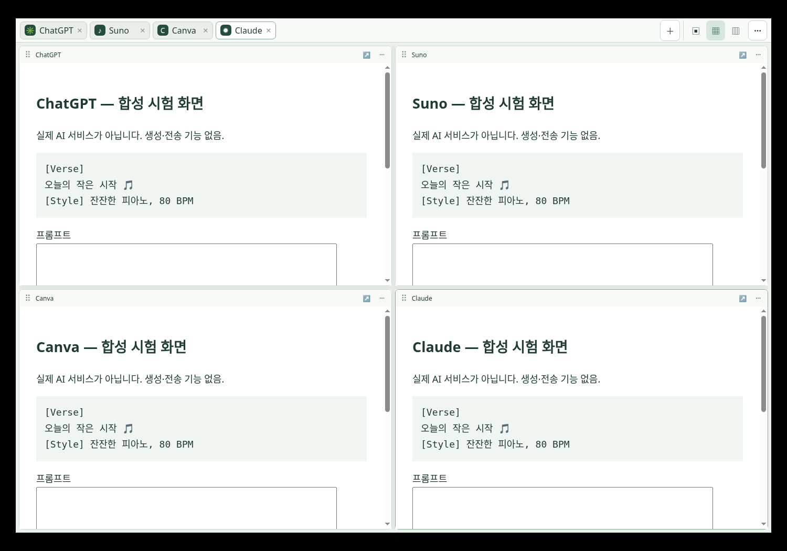
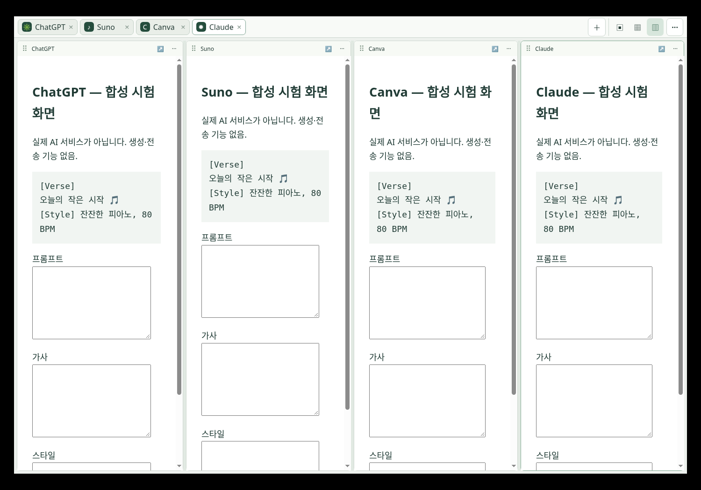

# Naru · 나루

**여러 AI 작업을 한곳에서 열고, 선택한 글을 다음 작업으로 옮기는 데스크톱 워크스페이스입니다.**

ChatGPT·Codex Cloud·Claude·Suno·Midjourney·Canva의 원본 웹 화면을 탭과 분할 패널로 사용합니다. 작업별로 별칭을 붙이고, 웹 주소와 배치를 로컬에 저장하며, 선택한 글을 다른 탭의 지정한 입력칸에 넣을 수 있습니다.

현재는 **사용자 설치 시험을 위한 프리뷰**입니다. 실제 서비스의 로그인 허용 여부와 로그인 후 입력 호환성은 아직 확인이 필요합니다. 다른 회사의 네이티브 앱을 안에 실행하는 가상화 도구는 아닙니다.

[다운로드 · Releases](https://github.com/leemh-dev/naru/releases) · [빌드 상태](https://github.com/leemh-dev/naru/actions/workflows/build.yml) · [오류 제보](https://github.com/leemh-dev/naru/issues)

## 다운로드와 실행

Releases에서 **Assets**를 펼쳐 운영체제와 CPU에 맞는 파일을 받으세요. `Source code.zip`은 설치 파일이 아닌 개발 소스입니다.

| 환경 | 배포 파일 | 실행 방법 |
|---|---|---|
| Windows x64 | `naru-…-win-x64.exe` | 설치 마법사로 설치합니다. |
| Windows x64, 무설치 | `naru-…-win-x64.zip` | 폴더 전체를 풀고 `Naru.exe`를 실행합니다. |
| Mac Apple Silicon | `naru-…-mac-arm64.dmg` 또는 `.zip` | DMG에서 앱을 Applications로 옮기거나 ZIP의 `Naru.app`을 옮깁니다. |
| Mac Intel | `naru-…-mac-x64.dmg` 또는 `.zip` | Intel용 앱을 위와 같은 방식으로 사용합니다. |
| Linux x64 | `naru-…-linux-x86_64.AppImage` | 파일에 실행 권한을 부여한 뒤 실행합니다. |
| Debian·Ubuntu x64 | `naru-…-linux-amd64.deb` | 배포판 패키지 설치기로 설치합니다. |

릴리스에 실제로 첨부된 파일이 배포 완료된 파일입니다. 함께 제공하는 `SHA256SUMS.txt`로 다운로드 파일의 체크섬을 확인할 수 있습니다.

프리뷰는 **코드 서명·Apple 공증을 하지 않았습니다.** 운영체제 보안 정책이 설치·실행을 제한할 수 있습니다. 이런 경우 경고와 발생 단계를 기록하고 시스템 보호 기능을 일괄 해제하지 마세요. 설치 파일 생성 성공과 해당 OS에서 앱이 정상 실행되는지는 별도의 검증 항목입니다.

## 구현된 기능

| 기능 | 현재 동작 |
|---|---|
| 작업 탭 | 동일 서비스를 여러 번 열기, 고정된 서비스 표시와 사용자 별칭, 좌우 스크롤·드래그 |
| 화면 배치 | 단일 화면, 가로 **2×2**, 세로 **좌우 1×4**; 1~3개 자동 배치 |
| 패널 이동 | 머리글 핸들로 위치 교환·가장자리 분할, 경계 드래그로 비율 조절 |
| 작업 복원 | URL·별칭·표시 패널·배치·보관한 글을 이 PC에 자동 저장 |
| 글 전달 | 받을 칸을 먼저 지정한 뒤 선택 글 우클릭 → 대상 탭·필드 선택 |
| 원문 보호 | 입력 결과를 원문과 비교하고, 기존 글이 있으면 덮어쓰지 않고 중단 |
| 글 보관 | 선택한 글을 명시적으로 복사·보관하고 다른 작업에서 재사용 |
| 진단 | 로컬 로그, 미리 보기, JSON 내보내기, 수집 중지·삭제 |

최대 4개 패널을 동시에 표시하고 작업 탭은 최대 30개 유지합니다. 다섯 번째 작업을 표시하면 활성 패널 자리를 교체하며 기존 탭을 삭제하지 않습니다. 보관한 글은 최대 50개, 한 항목과 한 번의 전달은 최대 5만 자입니다.

아래는 **비민감 합성 화면으로 실제 앱을 실행한 증거**입니다. 실제 AI 서비스 로그인 후 동작을 보여 주는 화면은 아닙니다.

| 가로 2×2 | 세로 좌우 1×4 |
|---|---|
|  |  |

## 첫 사용과 입력 시험

1. 중앙 또는 상단의 `+`에서 서비스나 웹 주소를 추가합니다. 기존 비공개 대화 주소도 사용할 수 있습니다.
2. 각 서비스 화면에서 본인이 직접 정상 로그인합니다. 동일 서비스의 탭들은 로그인 세션을 공유합니다. 다른 브라우저에서 쿠키·비밀번호를 가져오지 않습니다.
3. 탭을 더블클릭해 별칭을 정합니다. 원본 대화 제목은 바꾸지 않습니다. 상단 배치 버튼으로 화면을 나눕니다.
4. 목적지의 **빈 텍스트 입력칸을 클릭한 다음 우클릭 → 받을 입력칸 지정 → 프롬프트·가사·스타일** 중 하나를 선택합니다.
5. 원문에서 필요한 부분을 선택하고 **우클릭 → 다른 작업에 넣기 → 대상 탭·입력칸**을 선택합니다.
6. 원문·줄바꿈 일치 여부와 실제 입력 결과를 확인합니다. **Naru는 메시지 전송·음악 생성·외부 게시 버튼을 자동으로 누르지 않습니다.**
7. 반복해서 쓸 글은 **우클릭 → 복사하고 보관**을 선택합니다. `··· → 보관한 글`에서 복사하거나 지정한 칸에 다시 넣습니다.

Suno의 가사와 스타일은 각각 다른 칸으로 지정하고 시험하세요. Canva는 실제 사용할 AI 기능의 프롬프트 칸을 지정하세요. 검색창에 글을 넣은 것을 디자인 편집 성공으로 판단하지 않습니다. 페이지가 이동하거나 입력 요소가 교체되면 받을 칸을 다시 지정해야 합니다.

시험에는 비민감 문구를 사용하세요. 기존 대화를 공개 공유하거나 기존 내용·설정을 변경할 필요는 없습니다. 입력 확인에서 멈추며 유료 생성 크레딧을 소비하지 않습니다. 로그인 차단·CAPTCHA·요금제 제한은 우회하지 않고 해당 단계의 제한으로 기록합니다.

## 문제 발생 시 진단 보고서

**`··· → 진단 보고서 → 내용을 확인 → 이 내용으로 파일 저장`** 순서로 JSON을 내보냅니다. 보고서는 자동 업로드되지 않습니다.

- **기록:** 앱·Electron·OS 버전, 서비스 종류, 실행 내 탭 번호, 오류 코드, 로딩·전달 시간, 원문 일치 결과, 글자 수·줄바꿈 수.
- **제외:** 대화·프롬프트 원문, 비공개 URL, 탭 별칭, 비밀번호·토큰·쿠키, 스크린샷, 서비스 콘솔 메시지와 원본 오류 스택.
- 수집은 기본으로 켜져 있으며 메뉴에서 끄거나 삭제할 수 있습니다. 로그는 약 512 KiB 파일 4개로 순환합니다.
- 실제 서비스가 표시한 오류나 로그인 성공 여부를 자동으로 해석하지 않습니다. 실패한 단계와 개인정보가 없는 오류 문구를 별도로 기록해 주세요.

[진단 수집 명세](docs/diagnostics.md) · [시험 기록 양식](docs/test-template.md) · [진단 화면 예시](docs/evidence/03-diagnostics.png)

이 저장소와 Issues는 공개되어 있습니다. 공개 제보 전 보고서를 확인하고 **브라우저 프로필·앱 데이터 폴더 전체·개인 대화 캡처는 첨부하지 마세요.**

## 저장 방식과 현재 한계

작업 URL·별칭·배치와 사용자가 보관한 원문은 로컬 `workspace.json`에 저장합니다. 로그인은 Electron의 서비스 세션 저장소에서 처리합니다. 이 데이터는 진단 내보내기에 포함하지 않습니다.

초기 `AI Workspace Preview` 버전과의 연속성을 위해 내부 앱 식별자와 데이터 폴더 이름을 유지했습니다. 표시 이름은 Naru이지만 기본 데이터 폴더 이름은 `AI Workspace Preview`입니다. 사용자 계정·OS에 따라 상위 경로가 달라집니다.

- **자체 계정·클라우드 동기화:** 아직 없습니다. 현재 작업 공간 하나를 PC에 저장합니다.
- **종료 후 복원:** URL·별칭·배치를 다시 엽니다. 입력 중인 글·스크롤·생성 진행 상태까지 복원하지 않습니다.
- **자동 입력 범위:** 받을 칸을 수동 지정합니다. iframe·새 팝업 창의 칸 지정, 자동 프롬프트 분류, 자연어 앱 명령은 지원하지 않습니다.
- **자료 종류:** 현재는 글 전달·보관입니다. 이미지·음악·파일 전달은 아직 구현하지 않았습니다.
- **클립보드:** 앱 밖 클립보드를 감시하지 않습니다. `복사하고 보관`을 선택한 글만 저장합니다.
- **배치:** 좁은 창에서 패널 최소 폭에 따른 가로 스크롤, 배치 되돌리기는 아직 없습니다. 단일 패널 확대를 이용할 수 있습니다.
- **권한:** 마이크·카메라 등 추가 권한은 이 시험판에서 허용하지 않습니다.
- **플랫폼:** 데스크톱 대상입니다. Android·iOS 앱은 구현하지 않았습니다.
- **Codex:** Codex Cloud 웹 화면을 엽니다. 원격 데스크톱 Codex와 다르며, 모든 Codex 기능의 지원을 의미하지 않습니다.

## 검증 범위

| 항목 | 현재 근거 |
|---|---|
| 개인정보 제외·로그 순환·배치·복원 데이터 | 자동 검사 |
| Linux 실제 Electron 창·네이티브 메뉴·원문 전달·재시작 | 합성 화면에서 확인 |
| 초기 Linux deb의 실행 파일 | 임시 추출 후 창 표시 확인; 시스템 설치 시험은 아님 |
| OS별 설치 파일 생성 | 해당 릴리스와 Actions 결과에서 확인 |
| Windows·macOS에서 실제 앱 실행 | 사용자 시험 필요 |
| ChatGPT → Suno·Canva의 로그인 후 전달 | **미검증** |
| 일반 브라우저보다 줄어든 조작·시간, 시장 수요 | **미검증** |

[초기 검증 기록](docs/build-results.md)에는 이름 확정 전 수행한 시험과 증거를 보존했습니다. 구현·패키징 성공만으로 실제 서비스 호환성이나 개발 가치가 입증되는 것은 아닙니다.

## 개발 환경

Node.js **22.12 이상**이 필요하며 CI는 Node.js 24를 사용합니다.

```sh
git clone https://github.com/leemh-dev/naru.git
cd naru
npm ci
npm run setup
npm start
```

Electron 45의 실행 파일 다운로드는 별도 단계이므로 `npm run setup`을 실행해야 합니다. 개발 의존성 버전은 잠금 파일에 고정합니다.

```sh
npm test                 # 진단·배치·저장 검사
npm run fixtures         # 실제 서비스에 접속하지 않는 합성 화면
```

Linux에서 실제 창 검사를 하려면 Xvfb, Python, Pillow, X11/Xtst 라이브러리가 필요합니다.

```sh
python tests/run-desktop-linux.py
python tests/check-packaged-linux.py  # 현재 버전 deb를 먼저 빌드해야 함
```

자동 캡처는 합성 화면 시험 스크립트에만 있습니다. 일반 앱은 자동으로 화면을 캡처하지 않습니다.

## 빌드와 릴리스

각 OS의 원래 환경에서 다음 명령으로 빌드합니다.

```sh
npm run dist -- --win --x64
npm run dist -- --mac --x64 --arm64
npm run dist -- --linux --x64
```

[GitHub Actions](.github/workflows/build.yml)는 Windows·macOS·Linux에서 각각 검사와 빌드를 수행합니다. 수동 실행은 설치 파일을 Actions Artifacts에 올리고, `v*` 태그는 세 빌드가 모두 성공한 뒤 파일과 체크섬을 사전 릴리스에 올립니다. 자동 업데이트 기능은 없습니다.

```text
src/                    Electron 앱, 탭·패널 UI, 입력 전달, 저장·진단
tests/                  개인정보 검사와 합성 화면·패키지 시험
docs/                   사용 기록 양식, 진단 명세, 검증 증거
.github/workflows/      세 OS 빌드와 릴리스 자동화
```

현재 별도의 오픈소스 라이선스는 지정하지 않았습니다. 공개 저장소라는 사실만으로 자유로운 재배포 라이선스를 부여하지 않습니다.
