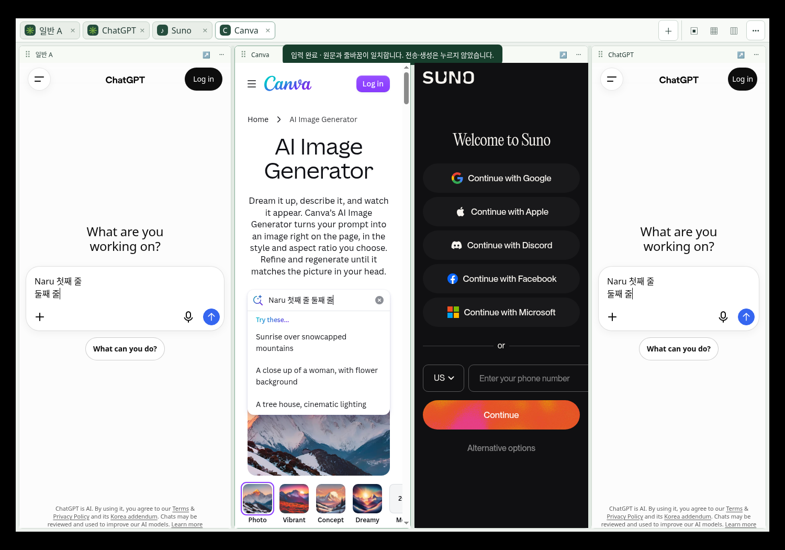

# Naru Linux 릴리스 실행 시험 · 2026-11-17

GitHub Releases의 **0.1.0-preview.1 AppImage를 내려받아 실제 Linux 창으로 실행**했습니다. 탭 추가·별칭·분할·드래그·보관한 글 재사용·진단 내보내기·정상 종료 후 작업 복원을 확인했습니다. 실제 ChatGPT 입력칸에 작성한 비민감 시험 글을 **Canva의 공개 AI Image Generator 입력칸**으로 옮기는 데 성공했습니다.

이는 ChatGPT가 생성한 답변이나 로그인 후 Canva 편집기·Suno 생성 화면에서의 검증은 아닙니다. 여러 줄 전달 시 Canva의 해당 단일 행 입력칸에서 줄바꿈이 사라졌고 Naru가 불일치를 표시했습니다. 일반 브라우저 대비 조작·시간 절감이나 시장 수요는 이번 시험으로 입증하지 않았습니다.

## 환경과 설치 범위

| 항목 | 실제 환경 |
|---|---|
| 시험 날짜 | 2026-11-17 UTC |
| OS | Debian GNU/Linux 13.6, Linux 6.18.57, x86_64 |
| 앱 | Naru 0.1.0-preview.1, Electron 45.3.3, Chromium 156.0.8078.100 |
| 배포 원본 | [GitHub 사전 릴리스](https://github.com/leemh-dev/plynt/releases/tag/v0.1.0-preview.1) |
| 실행 파일 | `naru-0.1.0-preview.1-linux-x86_64.AppImage` — 다운로드한 릴리스 파일을 그대로 사용 |
| 사용자 폴더 설치 | `/workspace/naru-installed/Naru.AppImage`에 배치·실행 권한 부여, 시험용 사용자 런처 작성 |
| 화면 | Xvfb X11 가상 디스플레이 1500×1050, 실제 Electron 앱 창 1440×980 |
| 조작·관측 | X11 실제 포인터·네이티브 메뉴와 로컬 CDP로 UI 조작 및 DOM 값 비교, X11 화면 캡처 |
| 서비스 프로필 | 이번 시험 전용 새 비로그인 프로필; 기존 사용자 브라우저 프로필에 연결하지 않음 |
| 네트워크 | 실제 `chatgpt.com`, `suno.com`, `www.canva.com` 공개 페이지 접속 |

가상 디스플레이에 실행한 **Linux 데스크톱 앱 시험**입니다. Android·iOS 앱 시험, Windows·macOS 실행 시험으로 취급하지 않습니다. 실제 웹사이트 시험에서는 합성 페이지 실행 옵션을 사용하지 않았습니다. 화면의 입력 글만 시험용으로 작성했습니다.

AppImage와 deb는 릴리스의 `SHA256SUMS.txt`와 모두 일치했습니다.

```text
AppImage  187faffd619c5e5afe6dffb0a3c1e0d0c6e0ba8231a1477c0346f2f4fd71af84
deb       40220f1f4cfb545d02ccb3ba465f4c1c52d6f5a56c89d5b87ca900e3915ed380
```

일반 AppImage 실행은 `libfuse.so.2` 부재로 종료 코드 1을 반환했습니다. 이 환경은 일반 사용자 계정이며 `sudo`가 없고 `/dev/fuse` 접근도 제한되어 있었습니다. AppImage의 공식 런타임 옵션인 `--appimage-extract-and-run`으로 실행했습니다. `--no-sandbox`는 사용하지 않았습니다. deb의 시스템 패키지 설치는 수행하지 않았습니다.

## 실제 결과

| 시험 | 판정 | 관측·한계 | 실패·미검증 원인 |
|---|---|---|---|
| 기본 AppImage 실행 | 실패 | `libfuse.so.2` 부재 | 시험 환경 문제 |
| AppImage 추출 실행 | 성공 | 실제 Naru 창과 원본 웹 페이지 표시 | — |
| deb 시스템 설치 | 미검증 | 파일·체크섬만 확인 | 시험 환경 문제: 관리자 설치 권한 없음 |
| 같은 ChatGPT를 두 탭으로 열기 | 성공 | 익명 홈 화면 2개를 별도 패널에 표시 | 비공개 대화 2개의 독립 상태는 미검증 |
| 탭 별칭 변경 | 성공 | 한 탭을 `일반 A`로 변경 | — |
| 2×2 / 좌우 1×4 전환 | 성공 | 두 배치의 실제 서비스 화면 확인 | — |
| 패널 드래그 교환 | 성공 | `일반 A / ChatGPT / Suno / Canva` → `일반 A / Canva / Suno / ChatGPT` | — |
| 분할 경계 드래그 | 성공 | 첫 패널 폭 약 355.5 → 406.3px | — |
| 탭·배치 전환 중 초안 유지 | 성공, 범위 제한 | 확인한 ChatGPT 입력칸의 14자 시험 글 유지 | 다른 서비스·다른 앱 왕복·모든 탭은 미검증 |
| 한 줄 글 → Canva 공개 입력칸 | 성공 | 20자 원문과 입력값 완전 일치 | 로그인한 편집기와는 다른 화면 |
| 여러 줄 글 → 같은 Canva 입력칸 | 원문 보존 실패·감지 성공 | 줄바꿈 1개가 공백으로 바뀜; 불일치 알림 및 `changed` 기록 | 대상 단일 행 입력칸의 제약 |
| 기존 내용이 있는 칸에 보관 글 넣기 | 성공 | 기존 내용 유지, `occupied`로 중단 | — |
| 선택 글 복사·보관 | 성공 | 명시적으로 선택한 14자 시험 글 보관 | 자동 클립보드 수집 시험은 아님 |
| 정상 종료 후 탭·배치 복원 | 성공 | 탭 4개·별칭·Canva 경로·패널 순서·조절 폭 복원 | — |
| 종료 후 입력 중인 글 | 서비스별 결과 다름 | 두 ChatGPT 탭에 14자 시험 초안 표시; Canva 입력칸은 빈 상태 | Naru가 초안 복원을 보장하지 않음 |
| 종료 후 보관 글 재사용 | 성공 | 보관 글 복원, Canva 받을 칸을 다시 지정한 후 입력값 일치 | 받을 DOM 요소의 재지정 필요 |
| 진단 미리 보기·JSON 저장 | 성공 | 앱의 실제 파일 저장 대화상자로 JSON 내보냄 | — |
| 진단 내용 제외 확인 | 성공, 이번 표본 | 시험 원문·탭 별칭·페이지 URL이 보고서에 없음을 확인 | 모든 민감정보 유형을 실데이터로 시험한 것은 아님 |
| Suno 가사·스타일 입력 | 미검증 | `/create` 접근 시 로그인 화면으로 이동 | 로그인 제한 |
| Canva 로그인 후 디자인 편집기 입력 | 미검증 | 공개 소개·입력 화면까지만 접근 | 로그인 제한 |
| ChatGPT 생성 답변 선택·전달 | 미검증 | 전송하지 않은 시험 초안으로 전달 기능만 확인 | 이번 범위 밖 |
| ChatGPT 프로젝트·Codex·Claude·Midjourney | 미검증 | 이번 릴리스 실행 시험 대상에 포함하지 않음 | 이번 범위 밖 |
| 이미지·음악 파일 전달 | 미검증·미지원 | 현재 프리뷰는 글 전달·보관만 구현 | 제품 기능 미지원 |
| 스크롤 복원·완료 알림·다른 앱 왕복 | 미검증 | 이번 시험에서 비교하지 않음 | 이번 범위 밖 |
| 일반 브라우저 대비 조작·시간 개선 | 미검증 | 동일 작업의 비교군 시험 없음 | 이번 범위 밖 |

두 ChatGPT 탭을 열 수 있다는 결과가 서로 다른 계정·익명 초안·생성 작업의 완전한 격리를 의미하지는 않습니다. 재실행 후 두 탭에 같은 시험 초안이 표시된 것도 서비스의 저장 방식이 관여할 수 있습니다. 탭별 독립 복원을 보장하는 근거로 사용하지 않습니다.

## 글 전달의 정확한 범위

1. 실제 ChatGPT의 익명 입력칸에 `Naru 공개 입력 시험: 작은 등대`를 작성했습니다. 메시지를 전송하지 않았습니다.
2. 실제 Canva의 [공개 AI Image Generator 페이지](https://www.canva.com/ai-image-generator/)에서 `Describe what you want` 입력칸을 Naru의 받을 칸으로 지정했습니다.
3. ChatGPT 입력칸의 시험 글을 선택하고 네이티브 우클릭 메뉴에서 `다른 작업에 넣기 → Canva · 프롬프트`를 선택했습니다.
4. Canva 입력값과 원문이 일치함을 직접 비교했습니다. 링크 전달이나 파일 업로드가 아니라 **텍스트 삽입**입니다. 생성 버튼은 누르지 않았습니다.

진단에 기록된 한 줄 삽입·비교 시간은 약 **513ms**였습니다. 이 값에는 원문 선택, 받을 칸 지정, 메뉴 이동 등 사용자의 전체 조작 시간이 포함되지 않으므로 작업 시간 절감 수치로 사용할 수 없습니다.

여러 줄 시험 문구는 `Naru 첫째 줄\n둘째 줄`이었습니다. Canva의 해당 입력 요소는 단일 행 `input[type=search]`이며 결과는 `Naru 첫째 줄 둘째 줄`이었습니다. Naru가 `입력 결과가 원문과 다릅니다. 줄바꿈·글자 제한을 확인하세요.`라고 표시했습니다. Canva 전체 기능이나 다른 편집기 입력칸에서도 반드시 같은 결과가 난다는 의미는 아닙니다.

이후 Canva에 실제로 들어간 **한 줄 결과**를 선택해 보관했습니다. 정상 종료·재실행 후 받을 칸을 다시 지정하고 보관함에서 넣었을 때 보관 원문과 일치했습니다. 이는 처음의 여러 줄 원문을 복구한 결과가 아닙니다.

## 화면 증거

모두 실제 릴리스 앱의 X11 화면 캡처입니다. 시험용 글, 비로그인 공개 페이지와 빈 로그인 양식만 포함하며 계정 정보·개인 대화 내용은 없습니다. Canva의 예시 이미지는 공개 페이지에서 제공한 이미지이며 이번 시험에서 생성한 결과가 아닙니다.

| 증거 | 확인할 내용 |
|---|---|
| [01 · 2×2 실제 서비스 화면](evidence/linux-installed-preview.1/01-real-grid.png) | ChatGPT 두 탭, Suno 로그인 화면, Canva 공개 페이지 |
| [02 · 한 줄 전달 성공](evidence/linux-installed-preview.1/02-public-transfer.png) | 원문·Canva 입력값 및 일치 알림 |
| [03 · 줄바꿈 불일치](evidence/linux-installed-preview.1/03-newline-mismatch.png) | 두 줄 원문·한 줄 결과 및 불일치 알림 |
| [04 · 패널 교환·너비 조절](evidence/linux-installed-preview.1/04-panel-layout.png) | Canva를 두 번째로 옮긴 패널 순서와 조절된 폭 |
| [05 · 정상 종료 후 재실행](evidence/linux-installed-preview.1/05-restarted.png) | 복원한 탭·배치 및 서비스별 초안 차이 |
| [06 · 보관 글 재사용](evidence/linux-installed-preview.1/06-stored-text-reused.png) | 다시 지정한 Canva 입력칸에 보관 글을 넣은 결과 |



로컬 결과 원본은 시험 작업공간의 `/workspace/naru-release-test/evidence/`에 남겼습니다. `diagnostics.json`은 앱의 저장 대화상자로 내보낸 파일이고, `final-diagnostic-snapshot.json`은 후속 시험 뒤 미리 보기를 읽어 저장한 스냅샷입니다. 런타임 로그·브라우저 프로필·작업 데이터는 저장소에 올리지 않았습니다.

초기 자동 조작 중 같은 호스트의 탭 매핑·포커스·네이티브 메뉴 선택과 관련한 시험 스크립트 오류가 있었습니다. 해당 실패는 제품 오류로 계산하지 않았습니다. 위 결과는 실제 선택·대상 입력값·화면 및 진단으로 다시 확인한 항목입니다. 진단 화면의 CSP로 차단된 시험용 문자열 평가 역시 앱 기능 실패로 계산하지 않았습니다.

시험 종료 후 Naru를 정상 종료했고 로컬 디버깅 포트가 닫힌 것을 확인한 뒤 시험용 Xvfb도 종료했습니다. 다운로드한 실행 파일은 사용자 폴더에 보존했습니다.

## 결론과 다음 확인

**Linux에서 배포본을 실행해 실제 웹 화면 사이의 텍스트 삽입과 작업 배치·보관 기능이 작동하는 것은 확인했습니다.** Suno·Canva의 로그인 후 실제 작업에서 사용할 수 있는지는 여전히 미검증입니다. 전체 핵심 흐름이 완성됐다고 판단할 근거는 부족합니다.

다음 설치 시험은 정상 로그인한 Suno의 가사·스타일 칸과 Canva의 실제 사용할 편집기 입력칸에서 진행해야 합니다. 전송·생성 전에 멈추고, 여러 줄 보존·기존 글 보호·페이지 이동 후 재지정·정상 종료 후 복원을 확인하는 것이 우선입니다. 기존 브라우저와 동일 작업을 비교하기 전에는 추가 개발의 차별화나 시간 절감이 입증됐다고 결론 내리지 않습니다.
