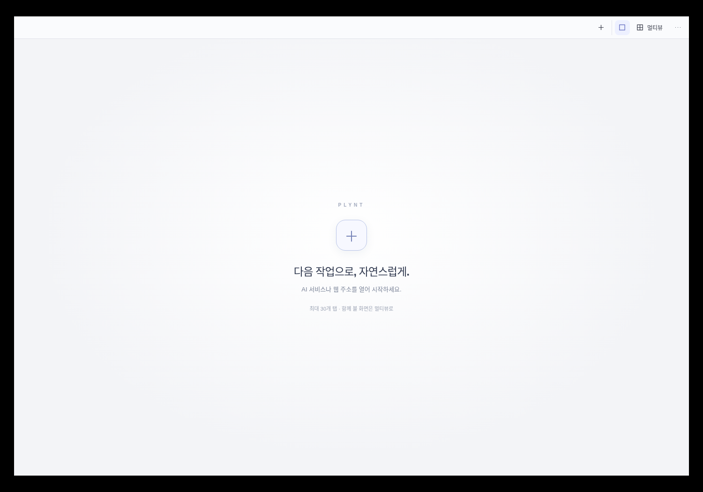

# Plynt(플린트) 이름 변경 · 2026-11-18

프로젝트 표시 이름을 Naru(나루)에서 **Plynt(플린트)**로 변경했습니다. 첫 이름 변경 커밋 `35419c2`는 앱의 기능과 버전(`0.1.0-preview.2`)을 유지했고 릴리스를 발행하지 않았습니다. 아래는 그 시점의 검증 기록입니다. 이후 설치 파일을 새 버전으로 빌드·게시한 결과는 [0.1.0-preview.3 배포 확인](preview.3-release.md)에 있습니다.

## 변경 범위

- 데스크톱 창 제목과 시작 화면, npm 패키지 이름, 설치 파일 이름, 제작자 표시.
- Android 앱 표시 이름, 시작 화면, 메뉴, 클립보드 레이블, 진단 보고서 이름과 내보내기 파일명.
- 공통 입력 코드의 브라우저 전역 이름(`PlyntInput`)과 Android 호출부.
- 한영 README, Android 빌드 안내, GitHub Actions 이름·APK 경로·향후 릴리스 제목.

기존 설치와의 연속성을 위해 데스크톱의 `dev.aiworkspace.preview` 식별자와 `AI Workspace Preview` 데이터 폴더, Android의 `dev.naru.mobile.preview` 패키지 ID·Java 경로를 유지했습니다. 사용자 프로필·로그인 세션을 복사하거나 변환하지 않았습니다. Android 빌드는 기존 서명 키와 `NARU_ANDROID_DEBUG_KEY` 환경 변수도 계속 지원합니다.

GitHub 저장소 주소는 현재 `https://github.com/leemh-dev/plynt`입니다. 기존 릴리스 파일·과거 검증 보고서·캡처에는 당시 이름을 보존했습니다. 이 이름들은 현재 제품 표시가 아니라 실제 주소, 호환성 식별자 또는 과거 증거입니다.

## 확인 결과

| 항목 | 이번 결과 |
|---|---|
| `npm test` | 통과 |
| Linux 합성 화면·입력 전달·진단 검사 | 기존 검사 30개 통과 |
| 정상 종료 후 합성 작업 복원 | 기존 검사 6개 통과 |
| 실제 Electron 시작 화면과 창 제목 | `PLYNT` / `Plynt` 확인 |
| `PlyntInput` 브라우저 전역 호출 | 입력칸 지정·여러 줄 입력·원문 일치·기존 글 보호 확인. 데스크톱 Chromium 보조 검증 |
| Linux x64 AppImage·deb | `plynt-…` 이름으로 빌드 성공 |
| Linux 패키징 결과의 실행 파일 | `dist/linux-unpacked/plynt`로 합성 시작 화면 표시 확인. 시스템 설치 시험은 아님 |
| Android 시험 APK | `plynt-0.1.0-preview.2-android-test.apk` 빌드·서명 검증 성공 |
| Android 패키지 메타데이터 | 표시 이름 `Plynt Mobile Preview`, 기존 패키지 ID 유지 확인 |
| Android 기존 로컬 APK와 서명 비교 | 인증서 SHA-256 일치 확인 |
| Android 기기에서 업데이트·실행·로그인 | 이번 변경에서 재시험하지 않음 |
| Windows·macOS 새 설치 파일·실행 | 이번 변경에서 재시험하지 않음 |

Linux 실행 환경은 Electron 45.3.3 / Chromium 156.0.8078.100 및 Xvfb입니다. 격리 환경의 소켓 제한과 SUID sandbox helper 설정 오류가 있어, 임시 시험 프로필과 합성 화면에 한해서 로컬 실행 래퍼에 `--no-sandbox`를 사용했습니다. 앱 소스·배포 설정의 샌드박스는 변경하지 않았습니다. 이 결과는 일반 환경의 보안 설정이나 실제 서비스 로그인 호환성을 검증한 결과가 아닙니다.

로그인된 프로필이나 실제 서비스 대화는 사용하지 않았습니다. 원본 런타임 로그와 시험 프로필은 저장소에 포함하지 않습니다.

## 화면과 결과

[화면·입력 검사](evidence/plynt-rename/desktop-results.json) · [재시작 검사](evidence/plynt-rename/restore-results.json) · [표시 이름·브라우저 입력 코드 검사](evidence/plynt-rename/branding-results.json)

## 2026-11-19 후속 통일

저장소는 `leemh-dev/plynt`로 변경됐고 Git 원격·현재 문서 링크·패키지 메타데이터를 갱신했습니다. Java 소스를 `dev.plynt.mobile.preview`로 옮기고 기존 런처는 호환 별칭으로 연결합니다. Android 앱 ID·런처 별칭과 이전 서명 설정, 과거 증거의 옛 이름은 설치·업데이트 및 기록 호환성 때문에 남깁니다. [현재 검증](preview.6-validation.md)
