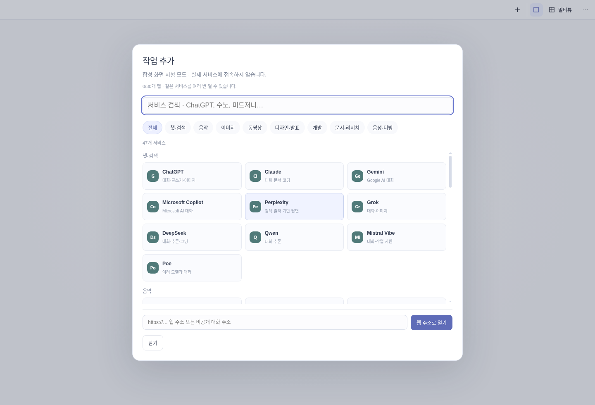
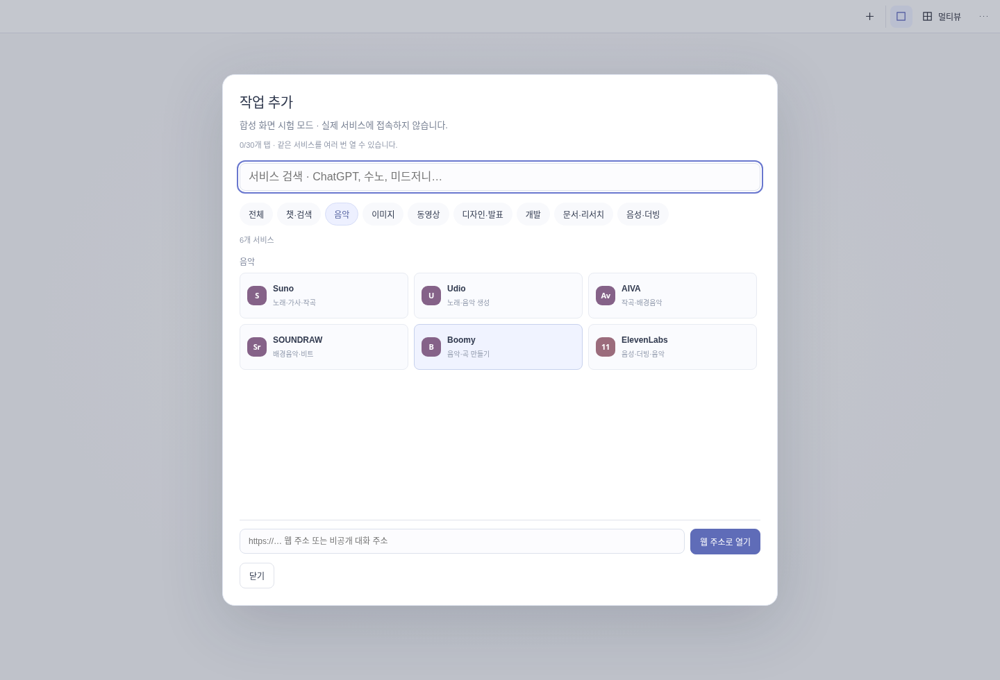

# preview.4: 분류별 AI 바로가기

확인일: 2026-11-18. 기존 6개 AI 바로가기를 **47개 서비스 / 8개 분류**로 확장했습니다. 데스크톱과 Android가 같은 `src/services.json`을 사용합니다.

## 사용자 동작

- `+` → 챗·검색, 음악, 이미지, 동영상, 디자인·발표, 개발, 문서·리서치, 음성·더빙 중 선택 → 서비스 열기.
- 한글·영문 이름과 이전 제품명으로 검색합니다. 검색어 입력 시 전체 분류에서 찾고, 분류를 선택해 결과를 좁힐 수 있습니다.
- 여러 용도를 가진 서비스는 관련 분류에 함께 나타납니다. 전체 목록에서는 중복 표시하지 않습니다.
- 웹 주소 직접 입력, 동일 서비스 여러 탭, 최대 30개 탭과 최대 4개 멀티뷰를 유지합니다.
- 기본 바로가기는 원본 웹사이트를 엽니다. 설치된 다른 회사의 네이티브 앱을 실행·내장하는 기능이 아닙니다.

[47개 서비스와 공식 확인 출처](ai-shortcuts.md). 제품 설명·주소 확인과 실제 로그인·생성 기능 시험은 별개입니다.

## 검증 결과

| 항목 | 결과 | 범위와 한계 |
|---|---|---|
| `npm test` | 통과 | 카탈로그 URL·분류, 기존/신규 서비스 복원, 진단 허용 목록 및 기존 입력·배치 검사 |
| Linux Electron 기존 GUI | 30개 통과 | 합성 페이지의 탭·멀티뷰·글 전달·진단 |
| 종료 후 다시 열기 | 6개 통과 | 합성 시험 프로필의 저장 상태 복원 |
| 새 바로가기 GUI | 14개 통과 | 47개 중복 없는 목록, 8개 분류, 한글 검색, 이전 이름 검색, 빈 결과, 사용자 URL, 같은 서비스 복수 탭, 목적지 활성화, 검색어 로그 제외 |
| 화면 검토 | 확인 | 실제 Linux Electron 창에서 전체 목록과 음악 분류 캡처 |
| Android APK 로컬 빌드 | 성공 | 공식 Android SDK 35 / Java 21; 번들의 공통 목록 47개 일치 확인 |
| Android 새 메뉴 실제 조작 | 미검증 | 이번 변경은 APK 빌드·번들 검사까지 수행 |
| 각 서비스 로그인·생성·입력 전달 | 미검증 | 서비스 바로가기 추가는 호환성 성공 판정이 아님 |
| Windows·macOS 실제 실행 | 미검증 | 설치 파일 빌드와 별개 |

Linux 시험은 Electron 45.3.3 / Chromium 156.0.8078.100, Xvfb에서 실행했습니다. 사용자의 프로필·실제 대화는 열지 않았습니다. 컨테이너의 sandbox helper 제한 때문에 별도의 **합성 시험 전용 실행 래퍼**에서만 `--no-sandbox`를 사용했습니다. 앱 소스와 배포 설정의 sandbox 설정은 바꾸지 않았으며 이 시험은 배포본 sandbox 검증을 대신하지 않습니다.

화면 캡처는 렌더링 완료를 기다린 뒤 저장하고 직접 확인했습니다. 검색어·주소·본문을 진단 로그에 추가하지 않았습니다. 빌드 산출물, 브라우저 프로필, 원시 로그, 서명 키는 저장소에 포함하지 않습니다.

## 증거

- [기존 GUI 결과 30개](evidence/preview.4/desktop-results.json)
- [복원 결과 6개](evidence/preview.4/restore-results.json)
- [바로가기 결과 14개](evidence/preview.4/service-picker-results.json)

## 배포

버전은 `0.1.0-preview.4`, Android 버전 코드는 4입니다. 기존 데스크톱 앱 ID·데이터 경로와 Android 패키지 ID는 유지합니다. Windows·macOS·Linux 및 Android 설치 파일은 모든 CI 빌드가 성공한 뒤 GitHub Releases에 게시하도록 설정되어 있습니다. 공개 배포 결과는 별도 확인해 이 문서에 추가합니다.
