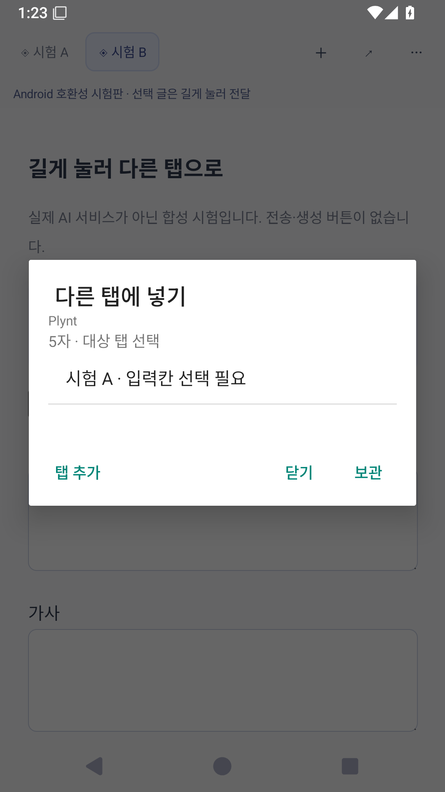
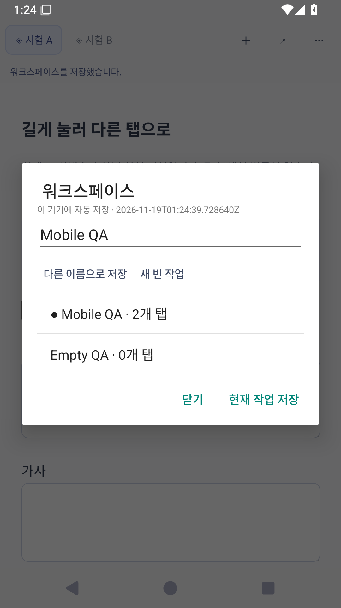
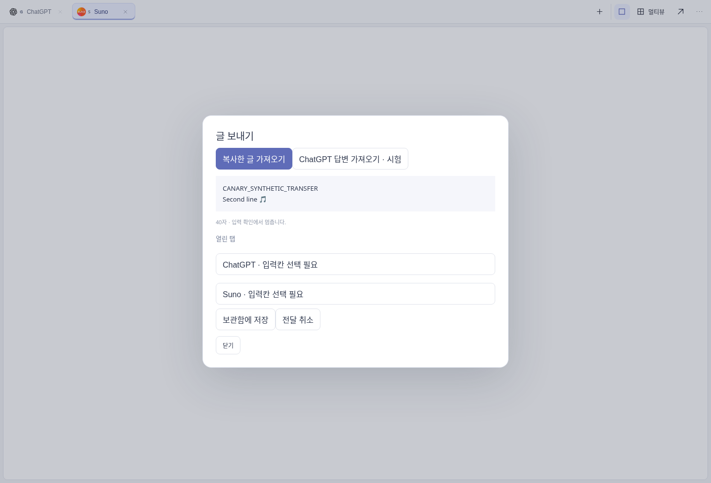
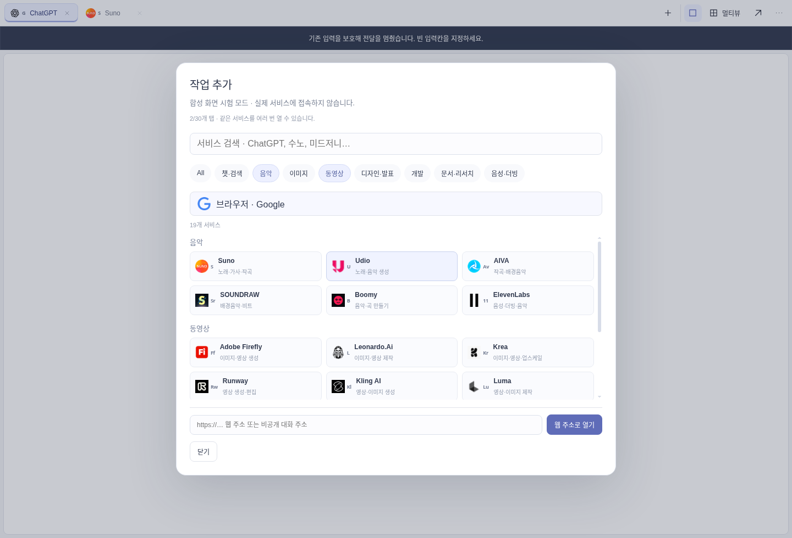
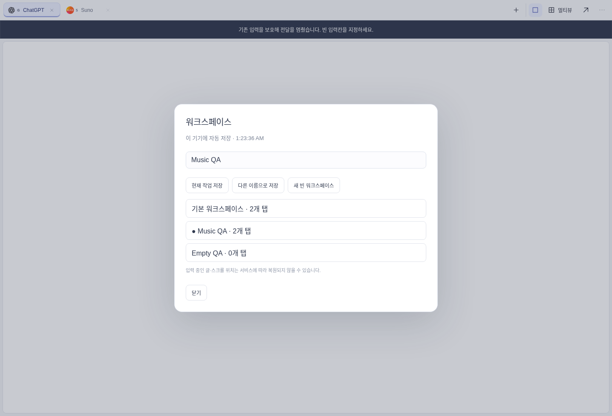
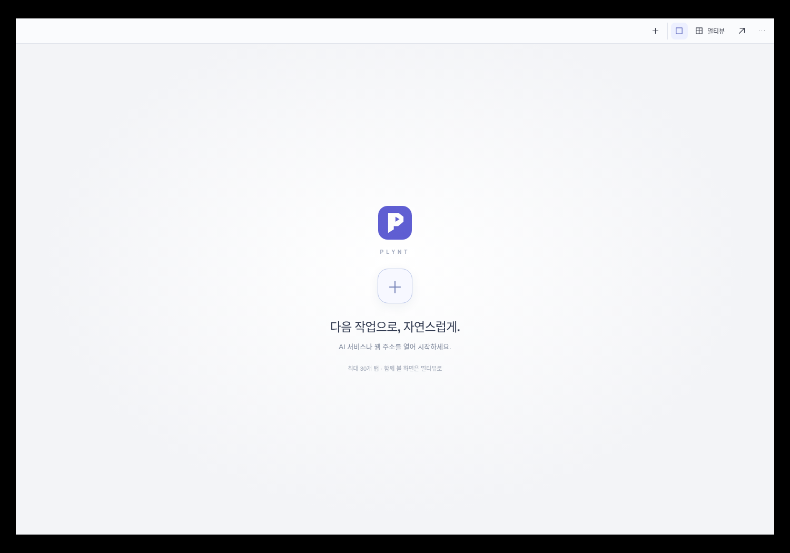

# Plynt preview.5 변경·검증 기록

선택한 **스파크 P** 아이콘과 Android·데스크톱의 전달·저장·서비스 선택 개선입니다. 시험 날짜: 2026-11-19 UTC. 실제 AI 서비스 계정이나 개인 대화를 시험에 사용하지 않았습니다.

## 바뀐 동작과 원인

| 사용자 보고 / 요구 | 변경 |
|---|---|
| 선택 후 다른 탭에 넣기가 사라짐 | 입력칸 미등록 탭도 목록에 포함. 선택 → 대상 활성화 → 빈 칸 터치 → 여기에 넣기. 글은 먼저 읽어 둔 뒤 선택 메뉴를 종료하며 실패하면 전달 대기로 유지 |
| 매번 블록을 지정해야 함 | 서비스 복사 버튼 → 상단 보내기 → 미리 보기·최근 목적지. 보관한 글도 같은 흐름 사용. ChatGPT 답변 가져오기는 명시적으로 누르는 실험 기능 |
| 워크스페이스가 저장되지 않는 것 같음 | 이름·저장 상태 표시, 자동 저장·직접 저장·다른 이름으로 저장·새 작업·전환. 기존 단일 저장본 이관, 원자적 파일 교체, 백업 복원 또는 손상 시 쓰기 중단 |
| 목록이 길고 분류가 불편함 | 검색 바로 아래 가로 스크롤 다중 분류. All 기본/초기화, 선택 분류 합집합·중복 제거, 필터를 유지한 검색, 더 촘촘한 항목 |
| 아이콘·일반 브라우저 부족 | 47개 서비스+Google 아이콘 번들. 아이콘·약자·이름 유지, Google 바로가기 고정. 외부 파비콘 서비스를 매번 호출하지 않음 |
| 로그인 유지 | 기존 영구 WebView/Electron 저장소 유지, 종료·백그라운드 시 쿠키 쓰기. 명시적 로그인 정보 삭제. 비밀번호 수집이나 다른 브라우저 쿠키 이동 없음 |
| 브랜드 적용 | 스파크 P를 Android 런처·빈 화면, 데스크톱 창·파비콘·설치 파일용 PNG/ICO에 적용 |

전달 중 중복 처리·워크스페이스 전환을 막고, 닫은 탭으로 남은 글을 보내지 않도록 검사합니다. 기존 입력을 덮어쓰거나 전송·생성 버튼을 누르지 않습니다. 여러 작업의 로그인은 같은 기기에서 공유하며 워크스페이스별 계정을 격리하지 않습니다.

데스크톱 사이트의 실제 복사 버튼을 흉내 낸 합성 HTTPS 페이지를 추가해 권한 거부 오류를 재현했습니다. 활성·표시된 최상위 탭에서 사용자 동작이 확인된 일반 클립보드 쓰기만 허용하도록 수정했습니다. 사이트의 클립보드 읽기와 백그라운드 쓰기는 차단되는지 함께 검사했습니다.

## 시험 환경과 증거 구분

- 로컬 Linux x86_64: Electron 45.3.3, Xvfb의 실제 창, 격리한 임시 프로필. 추가 배치·메뉴·전달·저장 검사를 실행했습니다. 제한된 컨테이너의 합성 시험에만 sandbox 우회 실행기를 사용하며 제품 실행 설정은 바꾸지 않았습니다.
- GitHub Windows·macOS·Ubuntu: 각 OS의 Electron을 직접 실행한 신규 기능 22개와 별도 프로세스 재시작 3개 검사. 단순 컴파일 성공과 구분합니다. macOS x64/arm64 패키지를 모두 만들지만 실행 검사는 러너의 CPU에서만 합니다.
- Android: Google 공식 API 35 x86_64 시스템 이미지, Pixel 2 프로필, KVM 에뮬레이터, 실제 네이티브 메뉴·WebView. 휴대폰 크기 데스크톱 브라우저를 사용하지 않았습니다. 테스트 전용 HTTPS 호스트를 앱 내부에서 합성 HTML로 응답하게 하며 실제 서비스의 TLS 검증은 그대로 유지합니다.
- 합성 쿠키와 합성 localStorage만 사용합니다. 인증정보를 추출하지 않았으며 실제 ChatGPT·Suno·Canva 로그인과 완료된 인증 후 입력은 **미검증**입니다.

[초기 데스크톱 3 OS 성공 실행](https://github.com/leemh-dev/naru/actions/runs/44433750588)에서 새 UI·전달·워크스페이스 검사를 통과했습니다. Android 초기 실패는 접근성 트리의 누락·오래된 덤프, 네이티브 떠 있는 선택 메뉴의 접근성 누락을 조사하여 검사기가 새 화면을 읽도록 보완했습니다. 고정 에뮬레이터의 메뉴는 화면 증거에 근거한 좌표 터치도 사용합니다.

## 결과

| 항목 | Linux | Windows / macOS | Android |
|---|---|---|---|
| 새 전달·미리 보기·미등록 목적지·초안 보호·최근 목적지 | 합성 실행 통과 | 합성 실행 통과 | 합성 실행 통과 |
| 다중 분류·All·Google·번들 아이콘 | 합성 실행 통과 | 합성 실행 통과 | 합성 실행 통과 |
| 이름 붙인 작업 저장·복사·빈 작업·전환·재시작 | 합성 실행 통과 | 합성 실행 통과 | 합성 실행 통과 |
| 합성 영구 쿠키 재시작 | 통과 | 통과 | 합성 실행 통과 |
| 실제 서비스 로그인 완료 / 로그인 후 전달 | 미검증 | 미검증 | 미검증 |
| 새 ChatGPT 답변 추출 | 합성 DOM에서만 통과 | 합성 DOM에서만 통과 | 합성 화면 범위 |
| 기존 멀티뷰·30개 탭·원래 전달 흐름 | 30개 UI+6개 복원 검사 통과 | 새 기능 검사와 별개 | 모바일 멀티뷰 미지원 |
| 설치 파일 생성 | AppImage·deb | exe·zip, 두 CPU의 dmg·zip | API 35 APK |
| OS 설치 관리자 전체 과정 | 별도 검사 범위 | 미검증 | 시험 APK 설치 과정만 |

Linux는 기존 50개(30+6+14)와 신규 25개(22+3), 합계 **75개 합성 UI·복원 검사**를 통과했습니다. `npm test`는 저장·복구·진단·배치 검사를 통과했습니다. [Linux 결과와 화면](evidence/preview.5/linux)

Android 네이티브·WebView **19개 검사 통과**: 분류·선택 메뉴·미등록 탭·정확한 입력·줄바꿈·초안 보호·답변 후보·이름 저장·빈 작업·전환·프로세스 재시작·합성 쿠키·localStorage·진단 원문 제외. Android 15, Android SDK built for x86_64, x86_64, WebView 124.0.6367.219. [성공 실행](https://github.com/leemh-dev/naru/actions/runs/44436242672) · [항목별 결과](evidence/preview.5/android/results.json)

| Android 대상 목록 | Android 작업 저장 |
|---|---|
|  |  |

## 화면

캡처는 비민감 합성 페이지에서만 촬영했습니다. 실제 사용자의 로그인 화면·대화가 아닙니다.

| 미리 보기·대상 선택 | 다중 분류·Google |
|---|---|
|  |  |

Linux deb를 임시 디렉터리에 풀어 포함된 실행 파일도 실행했습니다. 제한된 컨테이너에서는 SUID sandbox 설정 때문에 일반 실행이 중단되어, 로그인 없는 격리 합성 프로필에만 `--no-sandbox`를 적용해 시작 화면과 스파크 P를 확인했습니다. 시스템 전체 설치나 일반 계정의 sandbox 실행 성공으로 기록하지 않습니다. [패키지 시작 증거](evidence/preview.5/linux/packaged-result.json)

## Android 서명과 남은 제한

공개 preview.4 APK 인증서와 보관 키의 인증서를 비교한 결과 서로 달랐습니다. **preview.5를 preview.4 위에 그대로 업데이트할 수 없습니다.** 키가 없는 기존 APK를 재서명해도 기존 설치의 서명을 바꿀 수는 없습니다. 삭제하면 작업·쿠키가 지워지므로 URL과 필요한 자료를 별도로 보관하기 전 삭제를 권하지 않습니다. 데이터 내보내기·자동 이전은 구현하지 않았습니다.

향후 같은 문제가 반복되지 않도록 키가 없을 때 자동 생성하지 않고 빌드를 중단합니다. CI 임시 키는 시험에만 사용하고 자동 릴리스에서 제외합니다. 공개 APK는 저장소 밖의 보관 키로 서명하고 공개 지문을 검사한 뒤 첨부합니다. [공개 지문](android-signing.json) · [Android 안내](../mobile/android/README.md)

쿠키 저장이 서비스의 로그인 제한·만료를 해결하지는 않습니다. 페이지 내부 초안·스크롤·편집 상태는 복원 보장 대상이 아닙니다. 워크스페이스는 로컬이며 동기화·서비스 완료 알림·이미지/음악/파일 전달·iOS 앱은 없습니다. 정식 스토어 제출이나 공개 코드 서명도 이번 범위가 아닙니다.

## 최종 실행·배포

최종 버전은 `v0.1.0-preview.5`입니다. 태그에 연결된 CI의 모든 OS 검사가 통과한 뒤 데스크톱 릴리스를 생성합니다. 보관 키 APK와 전체 체크섬은 별도로 첨부하고, 실제 배포 확인 결과를 이 절에 추가합니다. 릴리스에 실제 첨부된 파일만 설치 가능 상태로 판단합니다.
